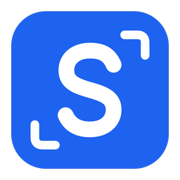

<p align="center">
  
</p>

<h1 align="center">Snapshoot</h1>

Snapshoot is a cross-platform screenshot tool for Windows and macOS. Take a screenshot, then annotate it, pin it on screen, capture a long screenshot, record the screen, run OCR, or translate it, all in one flow, without switching between several apps.

## Features

-   **Screenshot**: capture any selected area, with multi-monitor support.
-   **Quick capture**: optionally copy automatically once a selection settles. Copying, saving, or pinning opens a Quick Access overlay, and the latest 60 captures stay in local history for copy, save, share, OCR, or annotation.
-   **Annotate**: draw boxes, arrows, lines, mosaics, and text right on the screenshot, with crop and undo.
-   **Pin**: pin a screenshot or clipboard text on top of other windows. Image pins support zoom and opacity.
-   **Long screenshot**: automatically scroll and stitch a page, useful for web pages and long documents.
-   **Screen recording**: record a selected area to MP4 with adjustable resolution, frame rate, and quality. System audio or microphone, pause, and resume are supported. The file is saved automatically and copied to the clipboard. Requires macOS 12.3 or later; system audio needs macOS 13 or later.
-   **OCR**: recognize text in images with local and online services. On macOS, Apple Vision runs locally and returns text positions and QR codes.
-   **Translate**: selection, input, screenshot, OCR, and in-place translation over the frozen screenshot, with many translation services.
-   **Privacy redaction**: detect emails, phone numbers, keys, and tokens in a screenshot and mosaic them in one action.
-   **Sharing**: with WebDAV configured, upload a capture from Quick Access and copy its share link.
-   **History**: translation and recognition history can be searched and exported.
-   **Backup**: back up your configuration locally, to WebDAV, or to Aliyun Drive.
-   **External call**: other apps on the same machine can call translation, OCR, and more through `http://127.0.0.1:60828`. Each request must include the local token from Settings, in the `X-Snapshoot-Token` header or the `token` query parameter. The port can be changed in Settings.

## Shortcuts

All shortcuts can be changed in Settings -> Shortcuts. These are the defaults:

| Feature             | macOS               | Windows |
| ------------------- | ------------------- | ------- |
| Screenshot annotate | Command + Shift + A | F1      |
| Pin from clipboard  | Command + Shift + P | F3      |
| Screen recording    | Not set             | F2      |
| Selection translate | Not set             | Not set |
| Input translate     | Not set             | Not set |
| OCR recognize       | Not set             | Not set |
| OCR translate       | Not set             | Not set |

Selection, input, and OCR shortcuts are empty by default, and so is screen recording on macOS. Set one that feels comfortable the first time you use them.

## Download and install

Installers are on the GitHub Releases page:

https://github.com/shenziggy0/snapshoot/releases

v1.2.0 provides three installers:

| System                              | File                            |
| ----------------------------------- | ------------------------------- |
| Windows 64-bit                      | `Snapshoot_1.2.0_x64-setup.exe` |
| macOS Apple silicon (M-series chip) | `Snapshoot_1.2.0_aarch64.dmg`   |
| macOS Intel                         | `Snapshoot_1.2.0_x64.dmg`       |

The exact file names are the ones attached to the Release.

### Windows

Run `Snapshoot_1.2.0_x64-setup.exe` and follow the installer.

### macOS

First check your chip: Apple menu -> About This Mac, look at the "Chip" line. Download the dmg that matches it: Apple M-series, or Intel.

1. Open the dmg and drag Snapshoot into the Applications folder.
2. On first launch, macOS may say the developer cannot be verified. This is because the installer is not signed and notarized by Apple. It does not mean the file is damaged.
3. Allow it once, then you can open it normally afterwards:
    - In Finder -> Applications, Control-click Snapshoot -> Open -> click "Open" in the dialog;
    - If you already double-clicked and it was blocked, go to System Settings -> Privacy & Security and click "Open Anyway" at the bottom;
    - Only as a last resort, run `xattr -cr /Applications/Snapshoot.app` in Terminal to clear the quarantine flag, then open it again.
4. On first screenshot and first shortcut use, macOS will ask for permission: go to System Settings -> Privacy & Security and turn on "Screen Recording" and "Accessibility" for Snapshoot, otherwise screenshots and shortcuts will not work.

## Privacy note

Translation and OCR service keys are entered by you in Settings and stored locally. They are not uploaded to a Snapshoot server.

The default translation service is Volcengine free. It does not need an API key, but it sends the text to Volcengine (ByteDance) at `translate.volcengine.com`, not to a Snapshoot server. In-place translation on a screenshot uses this default service too.

These three also are not Snapshoot servers, and they stay off until you select them in Settings:

-   Lingva translate: the text to translate is sent to `lingva.pot-app.com`, an upstream server, not a Snapshoot server.
-   ECDICT dictionary: the text to look up is sent to `pot-app.com/api/dict`, also an upstream server.
-   Aliyun Drive backup: exchanging the login token goes through `pot-app.com/api/ali_access_token`, also an upstream server.

None of these three is on by default. They are only used if you select them yourself in Settings.

## Build from source

You can also build from source. You need Node.js 21, pnpm 9, and Rust stable.

```bash
git clone https://github.com/shenziggy0/snapshoot.git
cd snapshoot
pnpm install
pnpm tauri dev
```

`pnpm tauri dev` runs it in development mode. To package it:

```bash
pnpm tauri build
```

Build output is under `src-tauri/target/release/bundle/`. To build only one target, for example:

```bash
pnpm tauri build --target aarch64-apple-darwin --bundles dmg
pnpm tauri build --target x86_64-apple-darwin --bundles dmg
pnpm tauri build -b nsis --target x86_64-pc-windows-msvc
```

## Feedback

For bugs or suggestions, please open an issue on GitHub:

https://github.com/shenziggy0/snapshoot/issues

Acknowledgement: Snapshoot is based on Pot (pot-app/pot-desktop), under the GPL-3.0 license.
