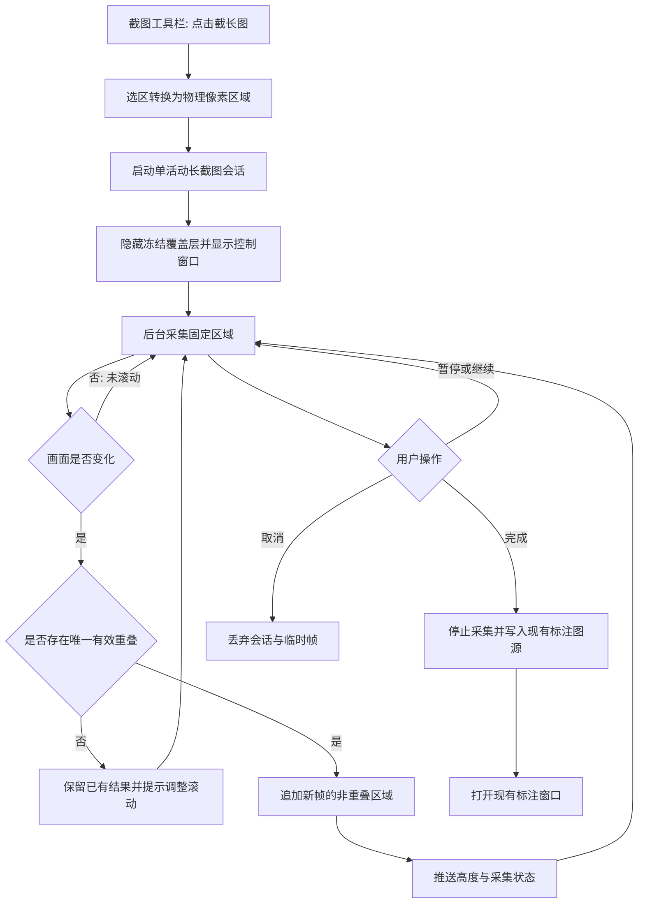

# 设计文档：滚动拼接截长图

- 日期：2026-10-31
- 状态：草稿

## 1. 需求理解

Snapshoot 当前采用“冻结单屏、框选、导出”的截图流程，无法把需要滚动查看的完整内容保存为一张图片。本需求在现有截图工具栏增加“截长图”入口，用户框选固定区域后手动向下滚动，应用自动采集、识别重叠内容并纵向拼接。

采集过程支持暂停、继续、完成和取消，并展示当前状态与输出高度。完成后复用现有标注窗口及复制、保存、贴图、OCR、翻译能力，不另建一套结果编辑器。

已只读核对 `README.md`、`package.json`、`src/window/Screenshot/index.jsx`、`src/window/Screenshot/Toolbar.jsx`、`src/App.jsx`、`src-tauri/src/screenshot.rs`、`capture_macos.rs`、`window.rs`、`annotate.rs`、`image_io.rs`、`main.rs` 与 `Cargo.toml`。现有文档没有长截图说明，与代码现状一致。

**关键假设：**

- 采用“用户手动滚动、程序自动采集”的方式，不模拟鼠标或键盘输入。
- 仅支持同一显示器内固定矩形区域的纵向拼接，输出格式为 PNG。
- 页面在采集期间保持窗口位置、宽度、显示器和缩放比例不变。
- 首期为单一活动会话，不增加全局快捷键、托盘入口或持久化历史记录。

**待确认事项：**

- 输出像素与内存上限的具体数值，在实现时结合目标 WebView 的 Canvas 能力和实测结果确定；达到上限时必须保留已有结果并明确提示。
- 动态页面、固定悬浮层及重复性极高内容可能出现匹配歧义，本期以“拒绝不可靠拼接并提示”为处理原则，不保证自动修复。

后续开发必须优先复用现有接口和模块，保持结构整洁，采用满足当前需求的最简单方案，不为假想需求增加抽象层；测试只覆盖核心拼接逻辑和关键用户路径。

## 2. 接口改动

### 2.1 前端到 Rust 的 Tauri 命令

新增命令统一放在 `src-tauri/src/long_screenshot.rs`，并在 `src-tauri/src/main.rs` 注册。沿用项目现有 `Result<T, String>` 错误形式，不引入数字错误码。

| 接口 | 入参 | 出参 | 错误与兼容性 |
| --- | --- | --- | --- |
| `long_capture_start` | `region: { x: u32, y: u32, width: u32, height: u32 }`，坐标为初始全屏图中的物理像素 | `LongCaptureStatus` | 区域为空、越界、已有活动会话或首帧不可用时返回 `Err(String)`；新增接口，不影响旧命令 |
| `long_capture_status` | 无 | `LongCaptureStatus` | 供新打开的控制窗口同步当前状态；无活动会话时返回错误 |
| `long_capture_set_paused` | `paused: bool` | `LongCaptureStatus` | 无活动会话或已完成时返回错误；暂停不清空已拼接结果 |
| `long_capture_finish` | 无 | `()` | 停止并等待采集任务退出后，写入现有标注图源并打开标注窗口；写入或窗口创建失败时返回错误 |
| `long_capture_cancel` | 无 | `()` | 停止任务并丢弃会话；重复取消按无活动会话处理，不产生用户文件 |

`LongCaptureStatus` 设计为：

```text
{
  state: "capturing" | "paused" | "error",
  width: u32,
  height: u32,
  message: string | null
}
```

新增事件 `long-capture-status`，负载为 `LongCaptureStatus`。仅在状态或输出高度变化时发送，控制窗口据此刷新，避免每帧传输完整 Base64 图片。

错误文案至少区分：采集失败、帧尺寸变化、无有效重叠、匹配歧义、输出达到上限和无活动会话。普通截图现有 `screenshot`、`read_capture_image`、`copy_png_base64`、`save_png_base64` 等命令的签名保持不变。

### 2.2 内部模块与数据流

- `src/window/Screenshot/index.jsx`：将 `exportBase64` 已有的选区到图像物理像素换算提取为共用函数；启动长截图时只传选区，不把标注图形带入拼接。
- `src/window/Screenshot/Toolbar.jsx`：增加“截长图”按钮，复用当前选区和工具栏样式。
- `src/window/LongScreenshot/index.jsx`：新增轻量控制页，提供暂停/继续、完成、取消及状态展示；在 `src/App.jsx` 注册 `long_screenshot` 标签。
- `src-tauri/src/window.rs`：复用现有窗口构建方式创建控制窗口。控制窗口默认放在选区外；无可用空间时，在单次采集前临时隐藏，采集后恢复。
- `src-tauri/src/screenshot.rs`：最小提取按固定显示器目标重复采集的能力，供普通截图与长截图共用，不复制 DPI 修正逻辑。
- `src-tauri/src/capture_macos.rs`：按会话保存的显示器 ID 采集，避免鼠标跨屏后目标漂移；继续复用现有屏幕录制权限检查。
- `src-tauri/src/long_screenshot.rs`：新增单活动会话、后台采集循环和纯图像拼接函数。现有代码没有滚动会话或重叠匹配能力，因此需要新增模块，但不再拆分无当前需求的抽象层。
- `src-tauri/src/annotate.rs`、`image_io.rs`：完成后直接复用 `cut_image_path()`、PNG 写入和 `open_annotate_window()`，不新增平行导出接口。
- `src/i18n/locales/*.json` 与 `README.md`：补充界面文案、手动滚动用法和限制说明。

会话内部保存采集目标、固定区域、当前 RGBA 结果、最后一帧有效画面和运行状态。图像处理在后台线程执行；窗口、剪贴板等操作继续走现有主线程机制。完成、取消和采集循环必须互斥，防止重复写入或释放后继续使用。

### 2.3 拼接规则

1. 首帧直接裁自当前冻结截图，后续帧按相同物理像素区域采集。
2. 完全相同的帧视为未滚动，不追加内容。
3. 将最后成功拼接帧的底部候选区域与新帧顶部候选区域比较；匹配使用中心区域的降采样灰度平均绝对差，输出仍使用原始 RGBA 像素。
4. 仅接受重叠充分、误差低于阈值且最优结果明确的候选，将新帧底部非重叠行追加到结果。
5. 无有效重叠或匹配歧义时跳过当前帧，保留最后有效结果，并提示用户减小滚动幅度或暂停动态内容；禁止直接硬拼。
6. 比较始终基于最后成功拼接的帧，而不是任意采集中间帧，避免一次失败丢失后续匹配基准。

## 3. 数据库改动

无。会话和图像仅保存在内存及现有应用缓存中，不新增表、字段、索引或迁移，无回滚 DDL。完成时复用 `pot_screenshot_cut.png` 作为现有标注窗口输入，不建立长截图历史库。

## 4. 流程图



## 5. 范围边界

- 本次做：
  - 现有截图工具栏入口和固定区域选择。
  - 用户手动滚动时的自动循环采集、暂停/继续、完成和取消。
  - 基于纵向重叠的图像拼接、重复帧抑制和不可靠匹配拒绝。
  - 输出状态提示、结果写入现有标注流程及多语言文案。
  - 核心拼接单元测试与关键截图路径回归测试。
- 明确不做：
  - 横向拼接、跨显示器采集和浏览器 DOM 全页截图。
  - 自动模拟滚动、OCR 语义拼接或页面结构分析。
  - 视频、动画等持续变化内容的可靠拼接。
  - 独立长截图结果编辑器、历史记录、数据库和云同步。
  - 新全局快捷键、托盘菜单项及第三方图像处理依赖。

## 6. 验收标准

- [ ] 给定两个由同一合成高图生成且具有已知重叠的帧，拼接结果与原图对应范围逐像素一致，无重复行或缺行。
- [ ] 输入完全未变化的帧时输出高度不变；输入无有效重叠的帧时返回不可拼接状态，且已有结果逐像素不变。
- [ ] 在可纵向滚动的静态页面框选区域，分段滚动并完成采集后，输出包含各段内容，拼接处无明显重复、缺失或横向错位。
- [ ] 采集过程中暂停后输出高度不再增长，继续后可在同一结果上追加；取消后不打开标注窗口、不生成新的用户输出文件。
- [ ] 完成后现有标注窗口能够读取结果，复制和保存仍调用现有命令，保存文件可正常解码且尺寸与完成状态一致。
- [ ] 在 macOS Retina 与 Windows 高 DPI 环境分别执行一次选区采集，首帧和后续帧边界一致，控制窗口不出现在结果中。
- [ ] 采集失败、帧尺寸变化或匹配失败不会清空已拼接结果；界面显示可理解的状态，用户仍能完成或取消。
- [ ] 不进入长截图模式时，现有框选复制、保存、OCR 和翻译流程行为不变。
- [ ] 后续验证只保留上述核心用例，不为极端边界增加冗余测试。

## 7. 影响面

- **直接影响**：截图覆盖层与工具栏、Tauri 窗口路由和命令注册、固定显示器采集、后台图像处理、国际化文案及使用文档。
- **复用但不改签名**：现有标注窗口、PNG 读写、剪贴板、贴图、OCR 和翻译命令。
- **下游调用方**：没有新增 HTTP 接口、插件协议或数据库消费者；新增 Tauri 命令仅供应用内两个窗口使用。
- **性能**：采集和匹配在后台执行；结果内存随输出像素数线性增长。匹配使用采样数据，状态事件不携带完整图片，避免高频 IPC 和主线程卡顿。
- **安全与权限**：继续使用现有屏幕录制权限和截屏后端，不绕过系统授权，不新增模拟输入权限，不把截图上传至外部服务。
- **兼容性**：目标平台沿用当前 Windows、macOS、Linux 支持范围；高 DPI 坐标转换是重点回归面。系统若不允许重复后台截屏，则明确报错，不扩大既有平台能力承诺。
- **资源边界**：达到预设输出上限后停止追加并保留结果，防止超长页面导致不可控内存增长。

## 8. 回滚方案

- 代码按功能提交边界回滚：移除 `long_screenshot.rs`、长截图控制页及命令注册，并恢复工具栏、窗口路由和采集模块的增量改动；不重写或回滚无关截图功能。
- 不设置持久化功能开关。需要紧急降级时，可仅隐藏“截长图”入口并取消活动会话，普通截图继续使用原有单帧流程。
- 若固定目标采集重构导致普通截图异常，优先回退 `screenshot.rs`、`capture_macos.rs` 的共用逻辑改动，再保留纯新增模块隔离处理。
- 无数据库和数据迁移，无需数据回滚。内存会话随取消或进程退出释放；缓存文件可保留且不影响旧版本，已由用户主动保存的 PNG 不删除。
- 出现稳定内容明显错拼、普通截图回归、高 DPI 区域偏移、跨显示器目标错误或内存持续增长时触发回滚。回滚后应恢复为现有单屏截图、标注和导出行为。
