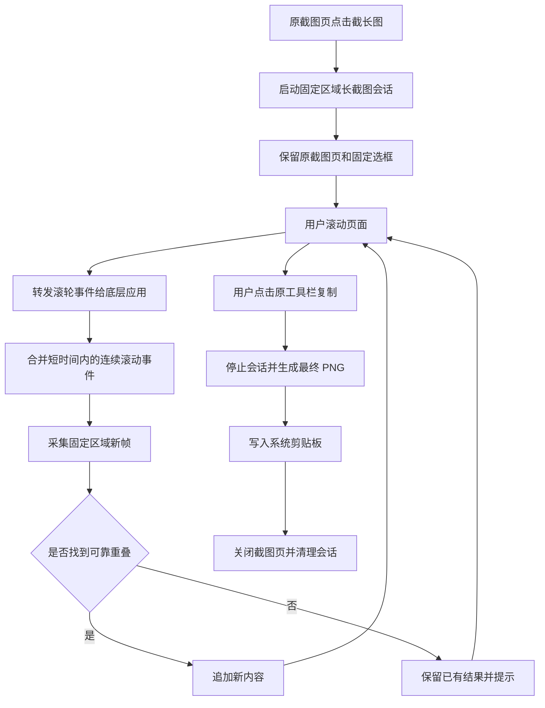

# 设计文档：原截图页内完成长截图

- 日期：2026-11-01
- 状态：草稿

## 1. 需求理解

当前长截图实现会打开独立控制窗口，并额外显示预览区域；这与目标交互不一致。目标是复用原截图页面：点击“截长图”后保留原选区和工具栏，用户在选区内正常滚动，选框固定而内容随滚动变化，点击原工具栏“复制”即完成并复制长图。

关键假设：

- 首期目标平台为 macOS，必须解决透明截图窗口拦截滚轮事件的问题。
- 长截图仍采用现有固定显示器、固定物理像素区域和重叠匹配算法。
- “复制”是长截图模式的完成动作；完成后直接写入剪贴板并结束当前截图窗口。
- 不再提供独立长截图控制窗口、暂停按钮和长截图预览窗口。

待确认事项：

- Windows/Linux 是否需要同样的原截图页内滚轮转发行为，待 macOS 版本验收后决定。
- macOS 辅助功能权限是否需要由事件转发实现触发；如果系统权限不足，应显示可理解的错误并结束会话。

## 2. 接口改动

### 2.1 Tauri 命令

沿用 `src-tauri/src/long_screenshot.rs` 的单活动会话和现有 `Result<T, String>` 错误形式。

| 接口 | 入参 | 出参 | 设计与兼容性 |
| --- | --- | --- | --- |
| `long_capture_start` | `region: { x, y, width, height }` | `LongCaptureStatus` | 保留；启动会话但不创建 `long_screenshot` 窗口，不隐藏原 `screenshot` 窗口 |
| `long_capture_finish_copy` | 无 | `()` | 新增；停止采集、写入最终 PNG、复制到系统剪贴板并清理会话 |
| `long_capture_cancel` | 无 | `()` | 保留；取消会话并恢复原截图页面 |
| `long_capture_status` | 无 | `LongCaptureStatus` | 保留；仅供原截图页同步状态，不再供独立控制窗口使用 |
| `long_capture_scroll` | `delta_y: i32` | `()` | 新增；将用户滚轮增量转发给底层应用，并触发一次合并后的采集任务 |
| `long_capture_set_paused` | 无 | 无 | 废弃；原截图页内流程不显示暂停按钮 |
| `long_capture_finish` | 无 | `()` | 废弃；完成动作统一使用 `long_capture_finish_copy` |
| `long_capture_preview` | 无 | 无 | 废弃；移除预览轮询和 Base64 预览数据 |

普通截图现有 `copy_png_base64`、`save_png_base64`、OCR、翻译和贴图接口保持不变。普通模式的复制继续使用原 `copy_png_base64`；仅长截图模式下将复制按钮路由到 `long_capture_finish_copy`。

### 2.2 前端状态与数据流

- `src/window/Screenshot/index.jsx` 增加 `longCaptureActive` 状态。
- 启动成功后隐藏冻结画布和普通编辑手柄，但保留固定选区边框与原工具栏。
- 工具栏 `onCopy` 根据 `longCaptureActive` 选择普通复制或长截图完成复制。
- `src/window/LongScreenshot/index.jsx`、`src/App.jsx` 中的独立控制窗口路由和状态轮询不再参与长截图流程。

## 3. 数据库改动

无。长截图会话仍仅保存在内存和现有应用缓存中，不新增表、字段、索引或迁移，因此无回滚 DDL。最终图片继续使用现有缓存路径和剪贴板写入能力。

## 4. 流程图

## 5. 范围边界

- 本次做：
  - 复用原 `screenshot` 窗口、选区状态和 `CaptureToolbar`。
  - 固定选区边框，隐藏冻结画面，使底层页面内容可继续滚动。
  - 在 macOS 转发用户滚轮事件，并按滚动动作触发采集和拼接。
  - 将原工具栏“复制”改为长截图模式下的完成并复制动作。
  - 删除长截图过程中的独立控制窗口、暂停操作和预览面板。
  - 保留现有重叠识别、尺寸限制、权限错误和缓存清理逻辑。
- 明确不做：
  - 自动滚动页面或模拟用户滚轮。
  - 横向拼接、跨显示器拼接和浏览器 DOM 全页截图。
  - 新增长截图历史记录、数据库或云同步。
  - 重新设计普通截图工具栏和其他截图动作。
  - 在长截图过程中展示独立预览窗口。

## 6. 验收标准

- [ ] 点击“截长图”后仍停留在原截图页面，不创建或显示独立长截图窗口。
- [ ] 选区位置和尺寸在长截图过程中保持不变，普通调整手柄不再改变长截图选区。
- [ ] 用户在选区内正常滚轮滚动时，底层页面实际滚动，选区边框保持固定。
- [ ] 连续滚动后，后台采集结果持续追加，不要求用户刻意放慢滚动速度。
- [ ] 点击原工具栏“复制”后，长截图会话结束，完整拼接图写入系统剪贴板。
- [ ] 完成后不弹出独立控制窗口或预览窗口，截图窗口正常关闭或退出长截图状态。
- [ ] 长截图取消后不复制结果、不生成新的用户输出文件，下一次普通截图可以正常启动。
- [ ] macOS 长截图启动、滚轮转发和点击复制过程中不出现 `EXC_BREAKPOINT`、`SIGTRAP` 或 AppKit 后台线程调用崩溃。
- [ ] 普通截图模式下复制、保存、OCR、翻译和贴图行为保持不变。

## 7. 影响面

- **前端**：`src/window/Screenshot/index.jsx`、`src/window/Screenshot/Toolbar.jsx` 的状态和复制动作路由；`src/window/LongScreenshot/index.jsx` 与 `src/App.jsx` 的独立窗口流程将被移除或停止使用。
- **后端**：`src-tauri/src/long_screenshot.rs` 的会话完成接口和采集触发方式；`src-tauri/src/capture_macos.rs` 增加滚轮事件转发；`src-tauri/src/window.rs` 调整截图窗口的固定选区和事件处理。
- **命令注册**：`src-tauri/src/main.rs` 增加完成复制和滚动转发命令，移除独立控制窗口专用命令的注册或调用。
- **性能**：采集由滚动事件触发并做短时间合并，减少无滚动时的全屏采集和预览 Base64 IPC；拼接结果内存仍随输出像素线性增长。
- **权限**：继续使用屏幕录制权限；滚轮转发若需要辅助功能权限，需在界面中明确提示，不能静默失败。
- **兼容性**：普通截图路径保持不变；macOS 为本次重点平台，其他平台保留现有行为并标记为待确认。

## 8. 回滚方案

- 代码回滚以功能提交为边界，恢复 `src/window/Screenshot/index.jsx`、`Toolbar.jsx`、`long_screenshot.rs`、`capture_macos.rs`、`window.rs` 和 `main.rs` 的长截图改动。
- 紧急降级时隐藏“截长图”入口，普通截图继续使用现有单帧流程。
- 移除新增命令注册和滚轮事件转发后，不需要数据库回滚，也不删除用户已经复制或保存的图片。
- 如果事件转发影响普通截图窗口，先回滚 macOS 原生事件处理，再保留不启用的长截图入口改动。
- 当出现滚轮无法传递、选区移动、普通复制回归或 macOS UI 线程崩溃时触发回滚。
