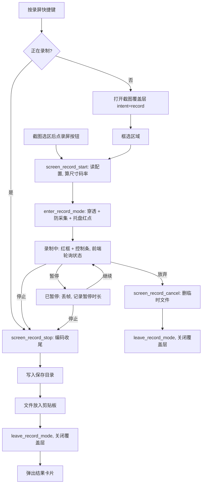

# 设计文档：区域录屏（Windows + macOS）

- 日期：2026-11-02
- 状态：草稿

## 1. 需求理解

Snapshoot 目前只能出静态图（截图、长截图）。本需求新增「区域录屏」：用户框选屏幕区域后录制成 MP4，录制中可暂停/继续/停止/放弃，停止后自动保存并把文件放入剪贴板，右下角弹出结果卡片。v1 同时支持 Windows 与 macOS，两端均需真机验收（用户已确认有 Mac 真机）。

预期行为：

1. 入口两个：截图选区后工具栏新增「录屏」按钮；或按录屏快捷键直接进入「录屏选区」模式（工具栏只显示「开始录制 / 取消」）。
2. 录制中：冻结背景和遮罩消失，露出实时桌面；录制区外框为红色虚线；框下方悬浮控制条（红点 + 计时、暂停/继续、停止、放弃）。红框与控制条不进入视频，控制条以外区域鼠标穿透可正常操作。
3. 录制中再次按录屏快捷键 = 停止。
4. 停止后：文件写入保存目录，文件（非图片）放入剪贴板，弹出结果卡片（缩略占位、时长、分辨率、大小，按钮：打开位置 / 删除），8 秒后自动关闭。

画质选项（设置页可选，Rust 侧读取配置）：

| 配置项 | 取值 | 默认 |
|---|---|---|
| 分辨率 `record_resolution` | `original` 原始物理像素 / `1080p` 长边不超过 1920 且短边不超过 1080 / `720p` 同理 1280×720 | `original` |
| 帧率 `record_fps` | 15 / 30 / 60 | 30 |
| 清晰度 `record_quality` | `high` / `standard` / `small` | `standard` |
| 录鼠标 `record_cursor` | bool | true |
| 系统声音 `record_system_audio` | bool | false |
| 保存目录 `record_save_dir` | 路径，空 = 系统「视频」目录下 `Snapshoot` 子目录 | 空 |

- 输出尺寸：先按分辨率档等比缩放，再截断为偶数；任何档位最长边不超过 4096（H.264 硬件编码器常见上限，5K 屏原始录制会被等比压到 4096）。
- 码率：`width × height × fps × bpp`，bpp 取 high 0.15 / standard 0.08 / small 0.04，平均码率模式。1080p30 约 9.3 / 5.0 / 2.5 Mbps。
- 编码：MP4 + H.264（High Profile），音频 AAC-LC 48kHz 双声道 160kbps。
- 文件名：`Snapshoot_YYYYMMDD_HHmmss.mp4`。

关键假设：

- 录制区只在单个显示器内（与截图一致，取鼠标所在显示器），不支持跨屏选区。
- 选区坐标沿用长截图的物理像素区域 `CaptureRegion`（`src-tauri/src/long_screenshot.rs`），前端用现有 `selectionImageRect` 计算。
- macOS 应用当前未设置 `minimumSystemVersion`，不提高整体最低版本；录屏能力按运行时系统版本开关：录屏需 12.3+（ScreenCaptureKit），系统声音需 13+；不满足时隐藏入口，截图功能不受影响。
- Windows 采用 Windows.Graphics.Capture（WGC），要求 Windows 10 1903+；Win11 可关闭黄色采集边框，Win10 会显示黄框，视为可接受。
- 录屏结果不写入历史记录数据库。

待确认事项：

- 录屏快捷键默认值：方案按 Windows `F2`、macOS 留空（与划词/OCR 等一致，由用户自设）。待确认。
- 麦克风：v1 不做，放第二期。待确认。
- `windows-capture` crate 是否满足「裁剪区域 + 缩放 + 自定码率 + 音频轨」：实施第一步做半天原型验证；不满足则直接用 `windows` crate 调 WGC + Media Foundation SinkWriter（见 2.3）。
- 剪贴板放文件：`arboard 3.4.1` 是否支持文件列表待确认；不支持时 Windows 用 `CF_HDROP`、macOS 用 `NSPasteboard writeObjects:[NSURL]` 原生实现。

## 2. 接口改动

### 2.1 Tauri 命令（新增，注册于 `src-tauri/src/main.rs` 的 `invoke_handler`）

均放在新模块 `src-tauri/src/screen_record/mod.rs`，状态由 `ScreenRecordManager`（`tauri::State`，参考 `LongCaptureManager` 写法）持有。

| 命令 | 入参 | 出参 | 说明 |
|---|---|---|---|
| `screen_record_support` | 无 | `{ supported: bool, system_audio: bool }` | 前端据此显示/隐藏录屏按钮与系统声音开关 |
| `screen_record_start` | `region: CaptureRegion` | `RecordStatus` | 读配置算输出尺寸与码率，进入录制覆盖层模式并启动采集编码线程 |
| `screen_record_status` | 无 | `RecordStatus` | 前端每 500ms 轮询，与 `long_capture_status` 同模式 |
| `screen_record_pause` | 无 | `RecordStatus` | |
| `screen_record_resume` | 无 | `RecordStatus` | |
| `screen_record_stop` | 无 | `RecordResult` | 收尾写文件、放剪贴板、关闭截图覆盖层、打开结果窗口 |
| `screen_record_cancel` | 无 | 无 | 停止并删除临时文件，关闭覆盖层 |
| `screen_record_last_result` | 无 | `RecordResult \| null` | 结果窗口读取 |
| `screen_record_reveal_last` | 无 | 无 | 在资源管理器/访达中定位最近一次结果 |
| `screen_record_delete_last` | 无 | 无 | 删除最近一次结果文件；只操作 Rust 记住的路径，不接受前端传入路径 |

数据结构：

```rust
// state: "recording" | "paused" | "finalizing" | "error"
struct RecordStatus { state: RecordState, elapsed_ms: u64, width: u32, height: u32, message: Option<String> }
struct RecordResult { path: String, width: u32, height: u32, fps: u32, duration_ms: u64, size_bytes: u64 }
```

错误：命令返回 `Err(String)`，取值为 i18n key（与长截图 `long_screenshot.*` 同模式）：`screen_record.unsupported`、`screen_record.permission_denied`、`screen_record.encoder_failed`、`screen_record.already_running`、`screen_record.disk_write_failed`。

### 2.2 修改的现有接口

- `long_capture_set_hit_rects` 重命名为 `overlay_set_hit_rects`（行为不变），长截图与录屏共用；`window.rs` 内 `LONG_CAPTURE_HIT_RECTS` / `set_long_capture_hit_rects` 同步改名为 `OVERLAY_*`。唯一前端调用点 `src/window/Screenshot/index.jsx:871` 一并修改。属内部接口，无外部兼容影响。
- `src-tauri/src/window.rs`：新增 `enter_record_mode()` / `leave_record_mode()`，复用 `apply_click_through`、`ensure_click_through_poller`、`set_excluded_from_capture`（Windows）、`capture_macos::exclude_from_capture`（macOS）；不调用 macOS 滚动专用的 `prepare_scroll_capture`。不复用 `enter_long_screenshot_mode` 本身的原因：它在 macOS 上会挂接滚轮转发，录屏不需要。
- `src-tauri/src/hotkey.rs`：新增 `hotkey_screen_record`，`default_hotkey` 增加 Windows `F2`、macOS `""`；在初始化注册与单项重注册两处 `match` 中各加一支。处理函数 `screen_record_hotkey()`：录制中 → 执行 stop；否则 → `prepare_screen_capture("record")` + `open_frozen_overlay()`。
- `src-tauri/src/screenshot.rs`：`INTENT` 新增取值 `"record"`，前端通过现有 `screenshot_intent` 读取，无签名变化。
- 托盘：录制中切换为录制图标（新增 `icons/tray_recording.png`、`icons_mac/tray_recording.png` 模板图），结束后恢复；不改托盘菜单。

### 2.3 平台实现（`screen_record/` 目录下）

- `mod.rs`：命令、状态机、`compute_output_size()`、`compute_bitrate()`、文件名与保存目录（`dirs::video_dir()`，已有依赖）。两端统一接口：不引入 trait，用 `#[cfg]` 选择 `windows::Recorder` / `macos::Recorder`，二者实现同名方法 `start / pause / resume / stop / cancel`。
- `windows.rs`：
  - 采集：WGC `GraphicsCaptureItem`（显示器）+ `Direct3D11CaptureFramePool`；`IsCursorCaptureEnabled` 按配置；Win11 设 `IsBorderRequired = false`。
  - 裁剪/缩放：D3D11 `CopySubresourceRegion` 取选区；需缩放时用 D3D11 VideoProcessor 输出 NV12。
  - 编码：Media Foundation `IMFSinkWriter`，H.264 硬件编码优先，`MF_MT_AVG_BITRATE` 设码率。
  - 系统声音：WASAPI loopback（默认渲染设备）→ SinkWriter 第二路 AAC 流。
  - 时间戳：视频帧 `SystemRelativeTime` 与 WASAPI QPC 位置同属 QPC 时钟，统一减去起始时刻与累计暂停时长。
  - `Cargo.toml` 的 `windows` 依赖需追加 features（`Graphics_Capture`、`Graphics_DirectX_Direct3D11`、`Win32_Graphics_Direct3D11`、`Win32_Graphics_Dxgi`、`Win32_Media_MediaFoundation`、`Win32_Media_Audio`、`Win32_System_WinRT_Direct3D11` 等，以编译通过为准）。若原型证明 `windows-capture` 可满足需求，则改用它替代自写的采集+编码部分。
- `macos.rs` + `macos_record.m`：
  - 用 `build.rs` 通过 `cc` crate（已在 `Cargo.lock` 中作为间接依赖，需加入 `[build-dependencies]`）编译一个 Objective-C 文件，链接 ScreenCaptureKit / AVFoundation / CoreMedia；Rust 侧通过 `extern "C"` 调用 `sr_start / sr_pause / sr_resume / sr_stop / sr_cancel / sr_supported`。理由：AVAssetWriter + SCStream 委托回调用 ObjC 书写最直接，项目已有 `objc` 用法但手写委托类成本高。
  - 采集：`SCContentFilter(display:excludingApplications:[当前应用])`，显式排除 Snapshoot 自身所有窗口，不依赖 `NSWindowSharingNone`；`SCStreamConfiguration.sourceRect` = 选区（点坐标），`width/height` = 输出像素，`minimumFrameInterval = 1/fps`，`showsCursor` 按配置；13+ 且开启系统声音时 `capturesAudio = true`、`excludesCurrentProcessAudio = true`。
  - 编码：`AVAssetWriter`（MP4）+ H.264 `AVVideoAverageBitRateKey` + AAC 输入。
  - 暂停：丢弃暂停期间样本，恢复后用 `CMSampleBufferCreateCopyWithNewTiming` 平移时间戳。
  - 权限：沿用截图已申请的「屏幕录制」权限；首次被拒返回 `screen_record.permission_denied`。

### 2.4 前端

- `src/window/Screenshot/Toolbar.jsx`：新增 `onScreenRecord` 按钮（`MdVideocam`），位于长截图按钮旁；`screen_record_support().supported` 为假时不渲染。
- `src/window/Screenshot/index.jsx`：新增 `recordActive` / `recordStatus` 状态；intent 为 `record` 时工具栏只显示「开始录制 / 取消」；录制中背景图层 `opacity: 0`（同长截图做法）、不画遮罩、选区边框改红色虚线，渲染控制条并通过 `overlay_set_hit_rects` 上报控制条矩形。
- 新增 `src/window/Screenshot/RecordControls.jsx`：计时、暂停/继续、停止、放弃。
- 新增结果窗口 `src/window/RecordResult/index.jsx`，窗口 label `record_result`，由 Rust 用 `window.rs` 现有 `build_window` 模式创建，定位到当前显示器右下角。
- 设置页：新增 `src/window/Config/pages/Record/index.jsx` 与路由 `/record`，用现有 `useConfig` 读写 2 节表格中的配置项；快捷键页增加 `hotkey_screen_record` 一行。
- i18n：`zh_CN.json`、`en_US.json` 补齐 `screen_record.*`、`config.record.*`；其余语言回退英文。

## 3. 数据库改动

无。录屏结果只落盘为文件，不写入 `tauri-plugin-sql` 历史库；配置项走现有 store 配置。

## 4. 流程图



## 5. 范围边界

- 本次做：
  - Windows 与 macOS 区域录屏，输出 MP4/H.264。
  - 分辨率、帧率、清晰度三组画质档位，录鼠标开关，系统声音（Windows 全支持，macOS 13+）。
  - 暂停/继续/停止/放弃，录制快捷键开始与停止，托盘录制态图标。
  - 自动保存、文件放剪贴板、结果卡片（打开位置、删除）。
  - 设置页「录屏」分组与快捷键项。
- 明确不做：
  - 麦克风、摄像头画中画。
  - GIF 导出、HEVC/AV1 编码、自定义码率数值。
  - 全屏录制、按窗口录制、跨显示器选区、录制中移动/调整选区。
  - 录制中标注、剪辑、预览播放器。
  - Linux 平台。

## 6. 验收标准

核心逻辑单元测试（仅纯函数，放在 `screen_record/mod.rs`）：

- [ ] `compute_output_size`：Given 选区 3001×1689、档位 `1080p`，Then 输出等比缩放且宽高均为偶数、不超过 1920×1080；Given 5120×2880、档位 `original`，Then 长边为 4096 且等比。
- [ ] `compute_bitrate`：Given 1920×1080、30fps、`standard`，Then 结果约为 4,976,640 bps。

真机验收（Windows 11 与 macOS 13+ 各执行一遍，macOS 另在 12.3～12.x 或以下验证入口隐藏可选）：

- [ ] Given 截图选区 800×500，When 点录屏并录 30 秒后停止，Then 3 秒内弹出结果卡片，保存目录出现 mp4，系统播放器可播放，时长 30±1 秒。
- [ ] 视频中不出现红色虚线框、控制条和截图遮罩。
- [ ] 录制中点击选区内外的其它应用可正常响应；点击控制条按钮生效。
- [ ] 录 10 秒 → 暂停 10 秒 → 再录 10 秒 → 停止，Then 视频时长 20±1 秒且无静止段。
- [ ] 开启系统声音，录制播放中的视频，Then 成片有声音且音画偏差不超过 100ms（肉眼对口型/拍手判断）。
- [ ] 三档分辨率在 Retina/高 DPI 屏上输出尺寸符合 1 节规则；画面内容与所框区域一致、无偏移。
- [ ] 停止后可在微信/资源管理器/访达中直接粘贴出该 mp4 文件。
- [ ] 录制中再次按录屏快捷键可停止；点放弃后不留下任何文件。
- [ ] 结果卡片「打开位置」定位到文件，「删除」后文件不存在，卡片 8 秒后自动关闭。
- [ ] 长截图功能回归：滚动拼接、穿透、复制完成均与改动前一致。

## 7. 影响面

- 模块：`window.rs`（覆盖层模式、hit rects 改名）、`hotkey.rs`、`screenshot.rs`（新 intent）、`main.rs`（注册命令与 State）、`tray.rs`（图标切换）、`build.rs` 与 `Cargo.toml`（macOS ObjC 编译、`windows` features）、截图前端与设置页。
- 长截图：共用穿透与 hit rects 逻辑，改名后需回归。
- 性能：录制期间 GPU 硬编，CPU 占用目标在 1080p30 下不超过单核 30%（观测项，非硬性验收）；1 分钟 1080p30 standard 约 37MB 磁盘写入。
- 安全与隐私：系统声音可能录入通知音，默认关闭；删除/定位命令只操作 Rust 记住的最近结果路径，不接受任意路径。
- 权限：macOS 复用屏幕录制权限，不新增 Info.plist 键（麦克风不在本期）。
- 兼容性：macOS 低于 12.3、Windows 低于 1903 时录屏入口隐藏，截图功能不变。安装包体积基本不变（不打包 ffmpeg）。

## 8. 回滚方案

- 代码回滚：功能为增量模块，按提交 `git revert` 即可；hit rects 改名为独立提交，可单独保留或回退。
- 数据回滚：无数据库变更；新增配置项残留在 store 中不影响旧版本运行。
- 降级手段：`screen_record_support` 返回 `supported: false` 即可整体隐藏入口（平台初始化失败时自动走此路径）。
- 触发条件：任一平台出现录制导致应用崩溃、长截图回归失败，或成片无法在系统播放器播放且短期无法修复。
