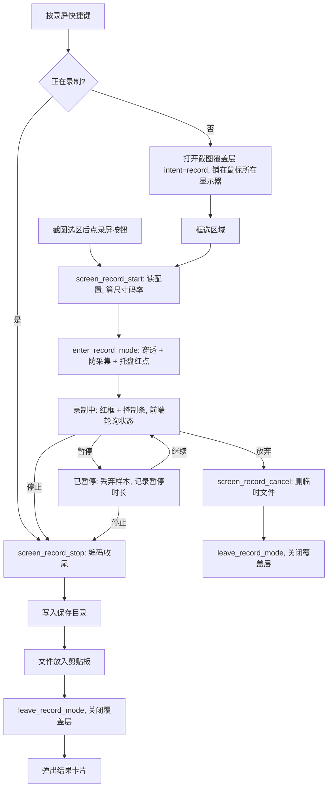

# 设计文档：区域录屏（Windows + macOS）

- 日期：2026-11-02（实现完成并更新：2026-11-03）
- 状态：已实现。Windows 见提交 df3f2d6，macOS 见提交 3617d41，分支 `feat/screenstudio`；两端均已真机验收通过，尚未合并到 `master`。

## 1. 需求理解

Snapshoot 目前只能出静态图（截图、长截图）。本需求新增「区域录屏」：用户框选屏幕区域后录制成 MP4，录制中可暂停/继续/停止/放弃，停止后自动保存并把文件放入剪贴板，右下角弹出结果卡片。v1 同时支持 Windows 与 macOS，两端均需真机验收。

预期行为：

1. 入口两个：截图选区后工具栏新增「录屏」按钮；或按录屏快捷键直接进入「录屏选区」模式（工具栏只显示「开始录制 / 取消」）。
2. 录制中：冻结背景和遮罩消失，露出实时桌面；录制区外框为红色虚线；框下方悬浮控制条（红点 + 计时、暂停/继续、停止、放弃）。红框与控制条不进入视频，控制条以外区域鼠标穿透可正常操作。
3. 录制中再次按录屏快捷键 = 停止。
4. 停止后：文件写入保存目录，文件（非图片）放入剪贴板，弹出结果卡片（缩略占位、时长、分辨率、大小，按钮：打开位置 / 删除），8 秒后自动关闭。

画质选项（设置页可选，Rust 侧读取配置）：

| 配置项 | 取值 | 默认 |
|---|---|---|
| 分辨率 `record_resolution` | `original` 原始物理像素 / `1080p` 长边不超过 1920 且短边不超过 1080 / `720p` 同理 1280×720 | `original` |
| 帧率 `record_fps` | 15 / 30 / 60 | 30 |
| 清晰度 `record_quality` | `high` / `standard` / `small` | `standard` |
| 录鼠标 `record_cursor` | bool | true |
| 系统声音 `record_system_audio` | bool | false |
| 保存目录 `record_save_dir` | 路径，空 = 系统「视频」目录下 `Snapshoot` 子目录 | 空 |

- 输出尺寸：先按分辨率档等比缩放，再截断为偶数；任何档位最长边不超过 4096（H.264 硬件编码器常见上限，5K 屏原始录制会被等比压到 4096）。
- 码率：`width × height × fps × bpp`，bpp 取 high 0.15 / standard 0.08 / small 0.04，平均码率模式。1080p30 约 9.3 / 5.0 / 2.5 Mbps。
- 编码：MP4 + H.264（High Profile），音频 AAC-LC 48kHz 双声道 160kbps。
- 文件名：`Snapshoot_YYYYMMDD_HHmmss.mp4`；同名已存在时依次追加 `_1`、`_2`…，不覆盖已有文件。

关键假设：

- 录制区只在单个显示器内（取鼠标所在显示器），不支持跨屏选区。
- 选区坐标沿用长截图的物理像素区域 `CaptureRegion`（`src-tauri/src/long_screenshot.rs`），前端用现有 `selectionImageRect` 计算。
- macOS 应用未设置 `minimumSystemVersion`，不提高整体最低版本；录屏能力按运行时系统版本开关：录屏需 12.3+（ScreenCaptureKit），系统声音需 13+；不满足时隐藏入口，截图功能不受影响。
- Windows 采用 Windows.Graphics.Capture（WGC），要求 Windows 10 1903+；Win11 关闭黄色采集边框，Win10 会显示黄框，视为可接受。
- 录屏结果不写入历史记录数据库。

已确认结论（原「待确认事项」）：

- 录屏快捷键默认值：Windows `F2`，macOS 留空，由用户在设置中自设。
- 麦克风：v1 不做，放第二期。
- `windows-capture` crate：不采用。它的音频接口忽略外部传入的时间戳，无法和视频共用 QPC 时间轴；改为用 `windows` crate 直接调用 WGC + D3D11 + Media Foundation SinkWriter + WASAPI loopback。
- 剪贴板放文件：`arboard 3.4.1` 没有文件列表接口。Windows 用 `CF_HDROP`（`DROPFILES` 结构），macOS 用 `NSPasteboard writeObjects:@[NSURL]`。

### 实现与原设计的差异

以下差异已体现在下文各节，这里集中列出，方便评审：

1. `RecordResult` 新增 `clipboard_copied: bool`。剪贴板写入失败时，结果卡片不再错误提示「已复制」。
2. 文件名冲突时追加数字后缀（见上文「文件名」）。
3. Windows 系统声音的写入方式：原设计是「每个 WASAPI 包按自带 QPC 时间定位」。实测这样做时，包时间戳的亚毫秒抖动会让几乎每个包都插入零采样或被裁掉重叠采样，约每 10ms 产生一次波形断点，听感为持续「滋滋」杂音（1kHz 测试音对照：修改前插零段 173 处、突变点约 870 处）。改为：首包用 QPC 定锚，之后按累计样本数连续写入；只有在包带 `AUDCLNT_BUFFERFLAGS_DATA_DISCONTINUITY` 或推算位置与已写位置偏差超过 50ms 时才重新对齐；超过 200ms 收不到任何包才补静音；暂停后继续时重新定锚，并保留迟到包中暂停之前的有效采样。修改后插零段为 0、突变点仅在暂停接缝处。
4. macOS 采集采用异步启动：`screen_record_start` 不在主线程上同步等待 ScreenCaptureKit 启动完成；权限预检失败直接返回错误，之后的初始化错误通过 `screen_record_status` 轮询上报。
5. macOS 静止画面时 ScreenCaptureKit 可能不再送新帧；停止时补一帧尾帧，保证成片时长与实际录制时长一致。
6. 实测中修复了两处原有问题（不属于录屏本身，但随本功能一起提交）：
   - 截图覆盖层只会铺在主屏：`cover_monitor_win` 原先用 `MonitorFromWindow` 取窗口所在显示器，而截图窗口创建时默认在主屏（问题来自提交 7945535）。改为按鼠标所在显示器铺开，见 2.2。
   - 设置窗口最小化后无法再次打开：`build_window` 对已存在窗口只调用 `set_focus`，见 2.2。

## 2. 接口改动

### 2.1 Tauri 命令（新增，注册于 `src-tauri/src/main.rs` 的 `invoke_handler`）

均放在新模块 `src-tauri/src/screen_record/mod.rs`，状态由 `ScreenRecordManager`（`tauri::State`，参考 `LongCaptureManager` 写法）持有。

| 命令 | 入参 | 出参 | 说明 |
|---|---|---|---|
| `screen_record_support` | 无 | `{ supported: bool, system_audio: bool }` | 前端据此显示/隐藏录屏按钮与系统声音开关；macOS 按运行时系统版本返回 |
| `screen_record_start` | `region: CaptureRegion` | `RecordStatus` | 读配置算输出尺寸与码率，进入录制覆盖层模式并启动采集编码 |
| `screen_record_status` | 无 | `RecordStatus` | 前端每 500ms 轮询，与 `long_capture_status` 同模式；macOS 异步初始化的错误也从这里上报 |
| `screen_record_pause` | 无 | `RecordStatus` | |
| `screen_record_resume` | 无 | `RecordStatus` | |
| `screen_record_stop` | 无 | `RecordResult` | 收尾写文件、放剪贴板、关闭截图覆盖层、打开结果窗口 |
| `screen_record_cancel` | 无 | 无 | 停止并删除临时文件，关闭覆盖层 |
| `screen_record_last_result` | 无 | `RecordResult \| null` | 结果窗口读取 |
| `screen_record_reveal_last` | 无 | 无 | 在资源管理器/访达中定位最近一次结果 |
| `screen_record_delete_last` | 无 | 无 | 删除最近一次结果文件；只操作 Rust 记住的路径，不接受前端传入路径 |

数据结构：

```rust
// state: "recording" | "paused" | "finalizing" | "error"
struct RecordStatus { state: RecordState, elapsed_ms: u64, width: u32, height: u32, message: Option<String> }
struct RecordResult { path: String, width: u32, height: u32, fps: u32, duration_ms: u64, size_bytes: u64, clipboard_copied: bool }
```

错误：命令返回 `Err(String)`，取值为 i18n key（与长截图 `long_screenshot.*` 同模式）：`screen_record.unsupported`、`screen_record.permission_denied`、`screen_record.encoder_failed`、`screen_record.already_running`、`screen_record.disk_write_failed`。

### 2.2 修改的现有接口

- `long_capture_set_hit_rects` 重命名为 `overlay_set_hit_rects`（行为不变，仍定义在 `long_screenshot.rs`），长截图与录屏共用；`window.rs` 内 `LONG_CAPTURE_*` 静态量与 `set_long_capture_hit_rects` 同步改名为 `OVERLAY_*` / `set_overlay_hit_rects`。前端唯一调用点 `src/window/Screenshot/index.jsx` 一并修改。属内部接口，无外部兼容影响。
- `src-tauri/src/window.rs`：
  - 新增 `enter_record_mode()` / `leave_record_mode()`，复用 `apply_click_through`、`ensure_click_through_poller`、`set_excluded_from_capture`（Windows）、`capture_macos::exclude_from_capture`（macOS）；不调用 macOS 滚动专用的 `prepare_scroll_capture`。不复用 `enter_long_screenshot_mode` 本身的原因：它在 macOS 上会挂接滚轮转发，录屏不需要。长截图与录屏互斥，任一进行中时另一个返回错误。
  - `set_excluded_from_capture` 改为返回 `Result`，录屏模式下设置失败即报错（长截图保持忽略）。
  - 新增 `record_result_window()`，用 `build_window` 创建 `record_result` 窗口并放到鼠标所在显示器右下角。
  - `cover_monitor_win`（Windows 截图覆盖层定位）：由 `MonitorFromWindow` 改为 `GetCursorPos` + `MonitorFromPoint(MONITOR_DEFAULTTONEAREST)`，按鼠标所在显示器铺开。两屏缩放比例不同时，窗口跨屏会触发 `WM_DPICHANGED` 并可能改掉窗口尺寸，因此铺开后在 40ms、160ms 各复核一次窗口矩形，不符则重设；用代号（generation）作废上一次放置留下的复核。
  - `build_window`：窗口已存在时先 `unminimize()`、`show()` 再 `set_focus()`。
- `src-tauri/src/hotkey.rs`：新增 `hotkey_screen_record`，`default_hotkey` 增加 Windows `F2`、macOS `""`；在初始化注册与单项重注册两处 `match` 中各加一支。处理函数 `screen_record_hotkey()`：录制中 → 执行 stop；否则 → `prepare_screen_capture("record")` + `open_frozen_overlay()`。
- `src-tauri/src/screenshot.rs`：`INTENT` 新增取值 `"record"`，前端通过现有 `screenshot_intent` 读取，无签名变化；截图时记下目标显示器（`record_capture_target()`），供录屏使用。
- 托盘：录制中切换为录制图标（`icons/tray_recording.png`；macOS 用 `icons_mac/tray_recording.png` 模板图），结束后恢复；不改托盘菜单。

### 2.3 平台实现（`screen_record/` 目录下）

- `mod.rs`：命令、状态机、`compute_output_size()`、`compute_bitrate()`、文件名与保存目录（`dirs::video_dir()`）。用 `#[cfg]` 分为 Windows、macOS、其它平台（返回不支持）三支，不引入 trait；各平台实现同名的 `supported()`、`Recorder::{start, status, pause, resume, stop, cancel}`、`copy_file()`、`reveal()`。
- `windows.rs`：
  - 采集：WGC `GraphicsCaptureItem`（显示器）+ `Direct3D11CaptureFramePool`；`SetIsCursorCaptureEnabled` 按配置；`SetIsBorderRequired(false)`（Win11 生效）。
  - 裁剪/缩放：D3D11 VideoProcessor，用源矩形裁出选区，同时完成缩放和 BGRA→NV12 转换。
  - 编码：Media Foundation `IMFSinkWriter`，启用硬件转换，`MF_MT_AVG_BITRATE` 设码率，H.264 High Profile。NV12 帧经 staging 纹理拷回内存再交给 SinkWriter（未做全程 GPU 零拷贝）。
  - 系统声音：WASAPI loopback（默认渲染设备，请求 48kHz/16bit/双声道并由系统自动转换）→ SinkWriter 第二路 AAC 流。写入策略见第 1 节「实现与原设计的差异」第 3 条。
  - 时间戳：视频帧与 WASAPI 都用 QPC 时钟，统一减去起始时刻与累计暂停时长。
  - 剪贴板：`CF_HDROP`。
  - `Cargo.toml` 的 `windows` 依赖追加了 WGC、D3D11、DXGI、Media Foundation、WASAPI、剪贴板相关 features，并新增 `chrono`（生成文件名）。
- `macos.rs` + `macos_record.m`：
  - `build.rs` 仅在目标为 macOS 时用 `cc` crate（加入 `[build-dependencies]`，复用 `Cargo.lock` 中已有的 1.1.31）编译 `macos_record.m`，启用 ARC；ScreenCaptureKit 弱链接（`-weak_framework`），另链接 AVFoundation、CoreMedia、CoreVideo、AudioToolbox、CoreGraphics、Foundation、AppKit。弱链接保证低于 12.3 的系统上应用仍能启动。
  - Rust 侧通过 `extern "C"` 调用：`sr_supported`、`sr_audio_supported`、`sr_start`、`sr_status`、`sr_pause`（暂停与继续共用）、`sr_finish`（停止与放弃共用，带 cancel 标志）、`sr_release`、`sr_copy_file`、`sr_reveal`。跨语言只传 C 基本类型、C 字符串和不透明指针。选用 ObjC 的理由：AVAssetWriter + SCStream 委托回调用 ObjC 书写最直接，项目已有 `objc` 用法但手写委托类成本高。
  - 采集：`SCContentFilter initWithDisplay:excludingApplications:exceptingWindows:` 显式排除 Snapshoot 自身所有窗口，不依赖 `NSWindowSharingNone`；`SCStreamConfiguration.sourceRect` = 选区（物理像素按显示器 scale 换算为点坐标），`width/height` = 输出像素，`minimumFrameInterval = 1/fps`，`showsCursor` 按配置，像素格式 `kCVPixelFormatType_420YpCbCr8BiPlanarVideoRange`；13+ 且开启系统声音时 `capturesAudio = YES`、`excludesCurrentProcessAudio = YES`。
  - 编码：`AVAssetWriter`（MP4）+ H.264 `AVVideoAverageBitRateKey` + AAC。音视频都用样本自带的 presentationTimeStamp，以第一帧视频时间为会话起点。
  - 暂停：丢弃暂停期间样本，继续后用 `CMSampleBufferCreateCopyWithNewTiming` 把之后的样本时间戳减去累计暂停时长；跨暂停边界的音频包用 `CMSampleBufferCopyPCMDataIntoAudioBufferList` 只保留边界之前的部分。
  - 线程：SCStream 回调、AVAssetWriter 写入、暂停状态读写都在同一串行队列上；Rust 侧等待原生回复有超时（暂停/状态 5 秒，收尾 35 秒），不在主线程上同步等待。
  - 权限：沿用截图已申请的「屏幕录制」权限；`SCShareableContent` 获取失败（未授权）时返回 `screen_record.permission_denied`。

### 2.4 前端

- `src/window/Screenshot/Toolbar.jsx`：新增 `onScreenRecord` 按钮（`MdVideocam`），位于长截图按钮旁；`screen_record_support().supported` 为假时不渲染。
- `src/window/Screenshot/index.jsx`：新增 `recordActive` / `recordStatus` 状态；intent 为 `record` 时工具栏只显示「开始录制 / 取消」；录制中背景图层 `opacity: 0`（同长截图做法）、不画遮罩、选区边框改红色虚线，渲染控制条并通过 `overlay_set_hit_rects` 上报控制条矩形。
- 新增 `src/window/Screenshot/RecordControls.jsx`：计时、暂停/继续、停止、放弃。
- 新增结果窗口 `src/window/RecordResult/index.jsx`，窗口 label `record_result`；`src/App.jsx` 接入该窗口，截图窗口按 Esc 时同时取消录制。
- 设置页：新增 `src/window/Config/pages/Record/index.jsx` 与路由 `/record`，侧边栏增加入口，用现有 `useConfig` 读写第 1 节表格中的配置项；快捷键页增加 `hotkey_screen_record` 一行。
- i18n：`zh_CN.json`、`en_US.json` 补齐 `screen_record.*`、`config.record.*`；其余语言回退英文。

## 3. 数据库改动

无。录屏结果只落盘为文件，不写入 `tauri-plugin-sql` 历史库；配置项走现有 store 配置。

## 4. 流程图



## 5. 范围边界

- 本次做：
  - Windows 与 macOS 区域录屏，输出 MP4/H.264。
  - 分辨率、帧率、清晰度三组画质档位，录鼠标开关，系统声音（Windows 全支持，macOS 13+）。
  - 暂停/继续/停止/放弃，录制快捷键开始与停止，托盘录制态图标。
  - 自动保存、文件放剪贴板、结果卡片（打开位置、删除）。
  - 设置页「录屏」分组与快捷键项。
  - 随本功能修复：截图覆盖层跟随鼠标所在显示器、设置窗口最小化后可再次打开。
- 明确不做：
  - 麦克风、摄像头画中画。
  - GIF 导出、HEVC/AV1 编码、自定义码率数值。
  - 全屏录制、按窗口录制、跨显示器选区、录制中移动/调整选区。
  - 录制中标注、剪辑、预览播放器。
  - Linux 平台。

## 6. 验收标准

核心逻辑单元测试（`cargo test` 共 6 个用例通过）：

- [x] `compute_output_size`：Given 选区 3001×1689、档位 `1080p`，Then 输出等比缩放且宽高均为偶数、不超过 1920×1080；Given 5120×2880、档位 `original`，Then 长边为 4096 且等比。
- [x] `compute_bitrate`：Given 1920×1080、30fps、`standard`，Then 结果为 4,976,640 bps。
- [x] Windows 音频连续写入（`windows.rs` 内两组纯函数测试）：包时间戳抖动不改变写入位置；真实断档与暂停后继续会重新定锚，且时间轴不倒退。

真机验收（Windows 11 与 macOS 各执行一遍，均已由用户实测通过）：

- [x] Given 截图选区 800×500，When 点录屏并录 30 秒后停止，Then 3 秒内弹出结果卡片，保存目录出现 mp4，系统播放器可播放，时长 30±1 秒。
- [x] 视频中不出现红色虚线框、控制条和截图遮罩。
- [x] 录制中点击选区内外的其它应用可正常响应；点击控制条按钮生效。
- [x] 录 10 秒 → 暂停 10 秒 → 再录 10 秒 → 停止，Then 视频时长 20±1 秒且无静止段。
- [x] 开启系统声音，录制播放中的视频，Then 成片有声音、无杂音，音画偏差不超过 100ms（人工听看判断）。Windows 另有 1kHz 测试音解码对照：插零段 0、暂停接缝以外突变点 0、音视频时长差约 5ms。
- [x] 三档分辨率在 Retina/高 DPI 屏上输出尺寸符合第 1 节规则；画面内容与所框区域一致、无偏移。
- [x] 停止后可在微信/资源管理器/访达中直接粘贴出该 mp4 文件。
- [x] 录制中再次按录屏快捷键可停止；点放弃后不留下任何文件。
- [x] 结果卡片「打开位置」定位到文件，「删除」后文件不存在，卡片 8 秒后自动关闭。
- [x] 长截图功能回归：滚动拼接、穿透、复制完成均与改动前一致。
- [x] Windows 双屏（主屏 2560×1600 @200%、副屏 1920×1080 @100%）：在副屏上截图、长截图、录屏均正常，覆盖层铺满鼠标所在屏。
- [x] 设置窗口最小化后，再次从托盘打开能还原到前台。

未覆盖：Windows 10 上的黄色采集边框、macOS 12.3 以下隐藏入口、Windows 10 1903 以下隐藏入口，本次未在对应系统上验证。

## 7. 影响面

- 模块：`window.rs`（覆盖层模式、hit rects 改名、覆盖层按鼠标所在显示器定位、已存在窗口还原）、`hotkey.rs`、`screenshot.rs`（新 intent、记录目标显示器）、`main.rs`（注册命令与 State）、`tray.rs`（图标切换）、`build.rs` 与 `Cargo.toml`（macOS ObjC 编译、`cc`、`chrono`、`windows` features）、截图前端与设置页。
- 长截图：共用穿透与 hit rects 逻辑，已回归。
- 截图（所有模式）：Windows 上覆盖层定位逻辑改变，多显示器、不同缩放比例下的行为与之前不同（之前总是铺在主屏）。
- 通过 `build_window` 创建的窗口（设置、翻译、识别、录屏结果）：已存在时会先还原再聚焦。
- 性能：录制期间 GPU 硬编，CPU 占用目标在 1080p30 下不超过单核 30%（观测项，非硬性验收，本次未测量）；1 分钟 1080p30 standard 约 37MB 磁盘写入。
- 安全与隐私：系统声音可能录入通知音，默认关闭；删除/定位命令只操作 Rust 记住的最近结果路径，不接受任意路径。
- 权限：macOS 复用屏幕录制权限，不新增 Info.plist 键（麦克风不在本期）。
- 兼容性：macOS 低于 12.3、Windows 低于 1903 时录屏入口隐藏，截图功能不变。安装包体积基本不变（不打包 ffmpeg）。

## 8. 回滚方案

- 代码回滚：功能分两个提交（Windows 及公共部分 df3f2d6、macOS 3617d41），可按提交 `git revert`。hit rects 改名、覆盖层定位修复、设置窗口还原修复都包含在 df3f2d6 中，无法单独回退；如需保留这两处修复而只撤录屏，需要手工拆分。
- 数据回滚：无数据库变更；新增配置项残留在 store 中不影响旧版本运行。
- 降级手段：`screen_record_support` 返回 `supported: false` 即可整体隐藏入口（平台初始化失败时自动走此路径）。
- 触发条件：任一平台出现录制导致应用崩溃、长截图回归失败，或成片无法在系统播放器播放且短期无法修复。
