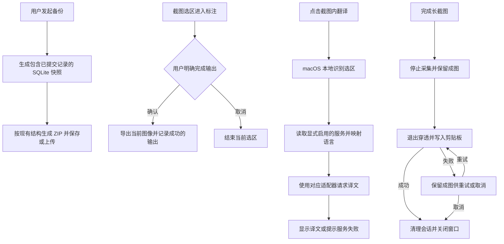

# 设计文档：Snapshoot 审查问题修复

- 日期：2026-11-13
- 状态：草稿
- 现状基线：`5d54b5d`

## 1. 需求理解

- 修复项目审查发现的八项问题，优先保证备份能恢复已提交的数据、截图在确认前不会将选区写入剪贴板和历史，以及翻译只使用用户选定的服务。
- 保留 OpenAI、Gemini 流式翻译和现有自定义地址能力。截图内翻译使用服务自己的语言编码，普通翻译和截图内翻译共用服务适配器。
- 假设本轮先在 Windows 隐藏依赖布局 OCR 的两个入口。普通 OCR、截图翻译和手工马赛克仍可用，补齐 Windows 布局 OCR 单独评估。
- 假设原截图标注页以显式复制、保存或钉图为输出时机，取消选区稳定后自动复制和留存的行为。已存在的历史按用户现有删除操作处理。
- 待确认的是长截图在真实 Windows、macOS 剪贴板失败后的表现，以及验收时可用的 OpenAI、Gemini 付费账户和模型。当前已用 SQLite、实际火山接口及 ego-lite 核对关键机制，这些证据不替代桌面应用验收。

### 文档与代码差异

| 位置 | 具体差异 | 来源提交 | 类型 |
| --- | --- | --- | --- |
| `README.md` 第 18、19 行与 `src-tauri/src/system_ocr.rs` 的 `system_ocr_layout`、`src/window/Screenshot/Toolbar.jsx` | 功能说明没有注明截图内翻译、自动打码仅支持 macOS。Windows 展示同样的入口，但布局 OCR 命令直接报不支持。 | `e8285d1c6765a3ec0b84cfd0fd56e8a41a5f27fb`，shenziggy0，2026-11-08，「优化整体的体验，与竞品对齐」。提交同时添加两项说明、工具栏按钮和仅在 macOS 执行的命令。 | 类型待确认。文档与实现同提交出现，无证据表明说明曾与 Windows 行为一致。 |
| `README.md` 第 21 行、`README_EN.md` 第 21 行与 `src/window/Config/pages/History/index.jsx`、`src/window/Translate/components/TargetArea/index.jsx` | 说明列出识别历史、搜索和导出。当前历史页使用翻译结果写入的 `history` 表，提供分页回看、编辑与清空。 | `c8a19d9fd1579f1aa81d6c62df7b9e7202a66eb3`，shenziggy0，2026-11-01，「chore:prepare Snapshoot v1.0.0 public release」。该提交新增中英文说明，当时历史页已只有分页查询等操作。 | 类型待确认。现有历史无法证明这些功能曾可用。 |

## 2. 接口改动

下表中的 Tauri 命令均为应用内部 IPC，沿用现有命令注册方式。表中新增命令和事件名称为设计名称。

| 路径及方法 | 入参与出参 | 错误与兼容性 |
| --- | --- | --- |
| `backup.rs` 的 `invoke('local')`、`invoke('webdav')`、`invoke('aliyun')` | 保留 `operate`、路径和各渠道参数及现有返回格式。仅替换创建 ZIP 时历史库的来源。阿里云盘的上传分支复用其现有 `local('put')` 产物。 | 沿用现有 `Result<String, Error>`。快照或打包失败时报告失败，禁止发布或上传半成品。现有 ZIP 成员命名和恢复入口兼容。 |
| `main.rs` 注册 `invoke('translate_stream')`，新增内部命令 | 输入请求 ID、已启用的服务实例键、文本和语言参数。后端按调用窗口与实例键发送 `translate-stream-chunk` 事件，事件包含请求 ID 与新增译文。命令完成时返回完整译文。 | 失败返回可供界面翻译的错误标识，区分配置无效、超时、上游失败及无法解析。复用当前 `setResult` 回调更新 UI。现有 OpenAI、Gemini 非流式分支沿用原接口。 |
| `translate_once.js` 的 `translateOnce(text, targetOverride)` | 保留函数签名和文本结果。读取现有目标语言设置，使用 `Language[语言键]` 映射，按显式配置顺序调用支持该目标语言的内置服务。 | 无可用服务时区分配置为空、语言不支持和服务调用失败。流式适配器传入有效结果回调并等待最终结果。字典对象和流式占位符不作为译文。 |
| `system_ocr.rs` 的 `invoke('system_ocr_layout', { data })` | 保留 Base64 图像入参与现有 `OcrLayout` 字段。截图工具栏复用 `src/utils/env.js` 的 `osType` 判断是否提供对应动作。 | 现有非 macOS 报错保留为兜底。环境未初始化成功时隐藏这两个入口。 |
| `quick_access.rs` 的 `invoke('capture_history_add', { data, action, showQuick })` | 参数与返回的历史记录结构保持兼容。截图页只在用户明确完成输出动作且操作成功后提交当时渲染的选区图像。 | OCR 与翻译仍是用户显式触发的识别操作，不自动写入截图历史。移除设置页的自动复制开关及截图页相关定时器。已有配置键可忽略，旧历史格式可继续读取。 |
| `long_screenshot.rs` 的 `invoke('long_capture_finish_copy')`、`invoke('long_capture_cancel')` | 无新增入参。完成命令成功仍返回 `()`。复制失败后，再调用同一完成命令重试已冻结的成图。取消仍释放会话。 | 保留字符串错误返回，区分可重试的输出错误和不可继续的采集错误。前端按结果显示重试或结束状态，普通截图的复制接口保持兼容。 |

流式网络请求沿用 `Cargo.toml` 已有的 `reqwest`，使用锁定版本支持的 `Response::chunk()` 读取响应。当前 Tauri HTTP 调用返回整包结果，无法继续用于逐段输出。后端从已保存的服务实例配置读取地址和凭证，限制服务类型与启用状态，继续支持该实例显式配置的自定义地址。按原适配器组装请求，仅向配置地址发送凭证，避免跨源重定向携带凭证。复用现有协议解析规则，修正跨块 UTF-8 和消息边界。事件仅发给调用窗口，前端只消费当前请求。保留 CSP 的本机连接范围和现有非流式路径。

普通翻译窗口、服务设置页和截图内翻译都从 `translate_service_list` 取得候选。检查 `defaults.js` 的 `migrateTranslateServices` 及其调用点，避免任何页面把公网兜底写回显式列表。火山可以作为可选择服务，首次发送给公网服务前以明确选择为依据。现有配置没有来源字段，无法区分之前自动加入和手动加入的火山实例。实施时不批量删除现有实例，并在升级说明中提示核对服务列表。移除截图内翻译跨次请求的内存结果缓存，避免配置变化后显示旧服务的译文。

原截图页复用 `finish`、`exportBase64` 与 `recordHistory`。复制或保存时使用实际导出的图像，既有 Quick Access 读取、删除和分享流程继续适用。移除自动复制 UI 后同步更新受影响语言文案和 README。已有历史里的旧原图由用户自行处理，已写入系统剪贴板或同步到其他应用的内容无法由本次升级撤回。

长截图保留 `LongCaptureManager` 单会话与拼接算法。完成时停止并回收采集线程，将成图保存在当前会话的内存状态，然后调用现有 `write_png`、`clipboard_on_main`。无论输出成功或失败都退出滚轮穿透，释放原生采集配置。输出失败时保留成图和重试入口，成功、取消或关闭时释放。复用现有会话锁协调完成与取消，避免重复消费或晚到回调更新下一次截图。

## 3. 数据库改动

无表、字段、索引或历史格式变更，无回滚 DDL。使用现有 `history` 建表定义，提取一处幂等初始化供 `History` 查询和 `TargetArea` 写入复用。先初始化再执行业务 SQL。清空使用 `DELETE FROM history`，成功后刷新列表并回到第一页。旧版本清空后表缺失的数据库可在首次打开时补建空表，原有数据和主键保持原样。

备份时在 `backup.rs` 提取一处快照写入逻辑，供本地和 WebDAV 打包复用。沿用锁文件中的 SQLx SQLite 版本，必要时将相同版本声明为应用的直接依赖。按 SQL 插件使用的应用配置目录打开源库，使用 `VACUUM INTO` 将已提交数据导出到独立临时 SQLite 文件。源库不存在时沿用原有可选成员规则。仅将生成的快照写入 ZIP 的 `history.db` 成员。先在临时路径完成 ZIP 并关闭文件，再替换目标归档或上传。打包失败时清理临时文件并保留已有备份。恢复验收以已关闭相关数据库连接的隔离目标目录为准，运行中覆盖数据库的恢复流程改造另行评估。

## 4. 流程图

## 5. 范围边界

- 本次做：一致性备份与历史清空，OpenAI 和 Gemini 流式网络通道，截图输出时机与翻译服务边界，截图内翻译的语言映射，布局 OCR 的平台入口控制，长截图失败收尾，以及对应说明更新。
- 明确不做：Windows 布局 OCR 实现、历史搜索和导出、批量删除旧截图、屏幕采集临时缓存改造、在线恢复重构、录屏或拼接算法改造、公开接口变更及 SWClaw 改动。
- 后续实施前先核对代码和仓库文档。优先复用现有接口、数据模型和模块，新增能力限于现有实现无法承担的职责。保持命名、接口和数据结构一致，清理替换后的旧分支。回归测试聚焦下列核心路径。

## 6. 验收标准

- [ ] 用真实 SQLite 数据库生成备份。保留打开的 WAL 连接并提交一条新增或修改记录，确认本地 ZIP 和有真实账户的云端渠道归档在隔离目录恢复后都包含该记录。核对阿里云盘与本地打包共用快照入口，渠道未跑通时单独标注。
- [ ] 首次打开空历史页可正常显示。清空已有翻译历史后立即重新打开页面，再翻译一条，页面可正常展示新记录，表结构保持一致。
- [ ] 从打包后的应用分别发起真实 OpenAI 和 Gemini 流式翻译。观察中间增量和最终文本，并用对应供应商的使用记录核对请求与实际计费。有自定义地址的实例走其配置地址。任何无法取得的计费证据按未验收记录。
- [ ] 截取含虚构敏感文字的选区，在选区停留超过 450ms 后取消，剪贴板和截图历史均无这次选区内容。再次截图，打码并显式复制，剪贴板与历史保存同一份打码图。
- [ ] 在 macOS 截图内翻译只配置真实本地 Ollama，验证本地成功与停用 Ollama 后的报错，核对两次均无公网翻译请求。显式选用火山时，真实接口收到 `zh` 并显示对应中文译文。
- [ ] Windows 真机验证两个布局 OCR 专用按钮隐藏，普通 OCR、截图翻译和手工马赛克可用。macOS 真机验证两个入口按现有布局识别正常工作。
- [ ] 先在原生应用验证长截图的正常复制，再用真实剪贴板不可写条件验证失败后退出滚轮穿透，恢复剪贴板后可直接重试同一张成图。取消或关闭后可开始新截图。

## 7. 影响面

- 本地、WebDAV、阿里云盘备份使用同一历史库快照规则。生成快照需要临时磁盘空间，完整性验证应包含备份和恢复两端。
- OpenAI、Gemini 继续使用现有服务实例及设置界面。流式请求从 WebView 转到 Tauri 后端，取消旧视图更新时按请求 ID 隔离。截图内翻译移除跨次缓存后，重复提交会产生新的上游请求及可能的计费。
- 截图工具栏、通用设置、Quick Access 与中英文使用说明受输出时机变更影响。历史图像和 ZIP 保持现有格式。Windows 用户需通过普通 OCR 或截图翻译入口完成相关操作。
- 长截图沿用 `window.rs` 的穿透清理和现有采集资源管理。验证长截图结束后能继续普通截图和录屏。

## 8. 回滚方案

- 按备份与历史、流式通道、截图与翻译策略、长截图收尾四个提交边界交付。发生持续备份失败、译文缺失、截图错误留存或长截图窗口无法退出时，只回滚对应功能提交及其说明。
- 新旧版本均可读取保持原结构的 ZIP 和历史表。保留最后一份独立验证通过的备份。发现归档缺失记录时暂停该版本的备份发布，从已验证备份恢复到隔离目录核对后再替换业务数据。旧归档中未写入的记录无法通过回滚补回。
- 流式通道故障时使用现有服务设置关闭流式输出。回滚时维持公网发送和截图保存的显式选择规则。必要时停用对应入口，避免恢复隐式公网兜底和打码前自动留存。
- 长截图收尾可独立回滚。若目标平台出现重复穿透或会话无法结束，在修复前禁用该平台的长截图入口，保留普通截图能力。
