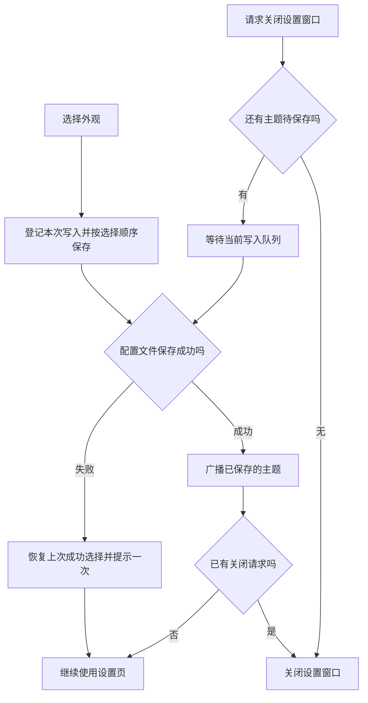

# 设计文档：桌面界面审查修复

- 日期：2026-11-24
- 状态：草稿
- 基线：`master` 的 `6ad050d`，加上本轮已审查的界面改版工作区。

## 1. 需求理解

- 优先修复翻译窗口白屏。上轮实机审查中，无发音的词条可以显示，带发音的 `hello` 触发了 `HiOutlineVolumeUp` 未定义异常，整个窗口随之清空。
- 其余七项涉及主题落盘、贴图菜单滚动、空输入换向、译文展开动效、录屏边框、译文读屏名称和重复通知。其中，主题使用的防抖写入、空输入换向和重复挂载通知在改版前已存在。
- 关键假设是保留现有桌面操作习惯、三个主题取值以及内置服务和插件的结果格式。录屏继续用红色虚线表达录制状态。
- 旧 WebKit 启动兼容性单独验收。已核实应用包声明最低 macOS 10.13，打包流程包含 Intel。可运行基线应用、使用 Safari 14 之前对应系统 WebKit 的 Intel Mac 仍待实测。录屏的 macOS 12.3 最低要求只适用于录屏功能。

### 文档与代码差异

| 位置 | 差异与处理 | 来源及类型 |
| --- | --- | --- |
| `docs/design/0003-区域录屏.md:13`（第 126 行亦有规定）与 `src/window/Screenshot/index.jsx:1387` 的 `recordActive` 分支 | RFC 要求红色虚线，当前工作区显示纯白虚线。按原约定恢复红色，再加深浅衬边。 | `df3f2d66a94455762deffa84f862f198624d5fcc`，ziggy，2026-11-03，《新增区域录屏（Windows）并修复副屏截图与设置窗口还原》，同次引入文档条款及红色虚线实现。HEAD 仍是红框。白框的来源提交未查到，改动尚在工作区。按提交历史分类为**类型待确认**，当前可定位为工作区实现偏离。 |
| `docs/design/0003-区域录屏.md:4` 的“尚未合并到 master”与 `src-tauri/src/screen_record/macos.rs` | 当前 master 已包含 macOS 录屏实现，修复边框可直接基于当前分支。 | `9daf17c71da06270d3fdfb33f71863ff81b3945c`，ziggy，2026-11-03，《更新区域录屏设计文档：标记已实现并补充实现差异与验收结果》，写入当时的分支状态。随后 `c8ab6b9912f9011d004802b848e1f7b758e492f2`，ziggy，同日，《合并 feat/screenstudio：区域录屏 macOS 实现》，将实现合入 master。类型为**文档过期**，仅涉及分支状态。 |

## 2. 接口改动

公开 HTTP 接口、Tauri 命令、翻译服务入参和词典结果格式均无改动。主题继续使用 `config.json` 的 `app_theme` 和已有事件 `app_theme_changed`，事件载荷仍为主题字符串。

| 拟调整的前端内部接口 | 输入与结果 | 失败处理及兼容性 |
| --- | --- | --- |
| `src/utils/store.js` 增加 `saveAppTheme(mode)` | 接受 `light`、`dark`、`system`，返回 `Promise<void>`。在选择事件中立即登记写入，按点击顺序执行 `await store.set`、`await store.save`，成功后广播现有事件。 | 写盘失败时拒绝 Promise，恢复上一项已保存的主题并提示一次。广播失败与写盘失败分别处理，已保存的值可以从文件重新读取。无新增公共错误码。 |
| 同模块增加 `waitForThemeSave(): Promise<void>`，为 `WindowControl` 增加可选回调 `onClose` | 等待当前设置窗口已受理的最后一次主题写入，空闲时立即完成。设置页的 Esc 和自绘关闭按钮等待它，再调用 `appWindow.close()`。其他窗口继续使用默认关闭行为。 | 原生标题栏关闭走 Tauri v1 的 `onCloseRequested`。在显示设置窗口前注册监听，返回等待写入的 Promise。成功后由 SDK 完成关闭，失败时调用 `preventDefault()`，由保存入口反馈一次。监听随窗口卸载解除。 |

`useConfig` 的常规写入有 500 毫秒防抖，现有 `forceSync` 参数也会走该定时器。设置页继续通过 `useConfig` 读取主题，外观选择器改走上表的即时保存入口，其他设置沿用原策略。待写 Promise 归设置窗口所有，切换设置子页时仍有效。连续选择按顺序完成，已被新选择替代的旧回调不能回写界面。若设置了插件缓存但写盘失败，按最后成功的值恢复该键。处理完失败项后清理待写状态，允许重试或正常离开。已确认的选中态及其他窗口的外观以保存结果为准，`src/App.jsx` 继续负责将配置应用给 `next-themes`。

## 3. 数据库改动

无。八项修复和兼容处理都无需改变 SQLite 的 `history` 表、索引或备份格式。主题复用原配置键和值，现有安装无需迁移，也无回滚 DDL。

## 4. 流程图

主题是本轮唯一需要协调文件写入与窗口销毁的操作。

## 5. 范围边界

| 修复项 | 实施位置与行为 |
| --- | --- |
| 1. 词典白屏 | 在 `src/window/Translate/components/TargetArea/index.jsx` 的发音列表中，以已有 `Volume2` 和带可访问名称的按钮替换未定义图标。沿用 `useVoice` 返回的 `speak` 播放服务提供的音频字节。音频缺失、为空串或空字节数组时省略该按钮，保留音标、释义和例句。 |
| 2. 主题持久化 | `src/window/Config/pages/General/index.jsx` 的外观选择、`src/window/Config/index.jsx` 的原生关闭监听、`src/App.jsx` 的设置窗口 Esc 和 `src/components/WindowControl/index.jsx` 的关闭按钮按第 2 节接入。关闭只需等待实际写入耗时。 |
| 3. 贴图菜单滚轮 | 在 `src/window/Pin/index.jsx` 的窗口级 `wheel` 处理器中，先判断事件目标是否在 `.snap-pin-menu` 内。菜单及其子控件交给原生滚动，判断必须早于 `preventDefault()`、缩放和透明度处理。指针位于图片上时沿用滚轮缩放、Ctrl/Cmd 加滚轮调节透明度。 |
| 4. 空输入换向 | `src/window/Translate/components/LanguageArea/index.jsx` 复用已有 `translateSecondLanguage`。自动检测且结果为空时，源语言继续为自动，目标在当前非备用语言和备用语言间切换。开启“记住语言”会写回当前目标，可在该窗口暂存上一个非备用目标供反向切换。配置尚未就绪或两者相同时保留有效目标。显式源语言仍交换两端，已有检测结果沿用现有分支。 |
| 5. 减少动态效果 | `src/main.jsx` 的系统偏好继续传给 `NextUIProvider`。结果卡从已有 `useProviderContext().disableAnimation` 读取同一值，传给 `useSpring` 的 `immediate`。减少动效时直接绑定最终高度，以便正在展开时切换偏好也能立即就位。常规模式保留原弹簧。 |
| 6. 录屏边界 | 只修改 `src/window/Screenshot/index.jsx` 的录制态选区和对应样式。使用 2 像素红色虚线，沿边框内侧加各 1 像素的浅色、深色衬线。内侧描边在贴屏边缘时仍可见。保留 `pointer-events: none`、实际选区坐标和原生排除覆盖层的路径。 |
| 7. 译文读屏名称 | 原文输入框沿用 `config.translate.source`。只读结果框以 `config.translate.target` 和当前服务实例显示名称组合命名，复用卡头的 `getInstanceName` 及内置服务、插件名称回退。切换服务时名称随之更新。 |
| 8. 重复通知 | 在 `src/window/Translate/index.jsx` 窗口根部挂载一个现有的 `src/components/Toaster.jsx`，放在服务列表外。移除原文区、各结果卡的挂载点，保留各操作发出 `toast` 的逻辑。 |
| 兼容项 · 旧 WebKit 启动 | 在 `src/main.jsx` 的 `listenForMotion` 按能力选择监听方式。现代 WebView 配对使用 `addEventListener('change', fn)` 和 `removeEventListener('change', fn)`。旧实现配对使用 `addListener(fn)` 和 `removeListener(fn)`。首次渲染直接读取 `matches`。旧机结果待验证。 |

实施分三步。先修翻译窗口白屏，并将换向、读屏名称、单一通知挂载点一起验证。第二步处理主题保存与关闭、系统动效订阅和结果卡弹簧。最后修贴图与录屏覆盖层，分别在 macOS、Windows 复验。

本轮限于上述交互。翻译供应商接入、全局配置存储重写、录屏编码及安装包发布另行处理。实施前应复核所列源码与仓库说明，沿用现有接口、组件、配置键与数据模型。仅扩展当前窗口缺少的写入等待和关闭职责。替换后删除旧入口与无效导入，测试集中覆盖第 6 节的用户路径。

## 6. 验收标准

- [ ] **词典与发音。** 在真实翻译窗口输入 `hello`，使用含可解码音频的真实词条。释义和发音按钮可见，点击可听到发音。再打开无发音词条，释义仍可读，窗口可继续输入。用项目已有的 TypeScript 在 `allowJs`、`checkJs`、`noEmit` 模式检查两个相关组件，JSX 图标及语言换向分支的未声明名称诊断应为零。
- [ ] **主题与关窗。** 从浅色切到深色后立即用标题栏关闭设置窗口，重开并重启应用均显示深色。在 macOS 原生关闭、Esc 和 Windows 自绘关闭入口复验。快速连续选择三种模式，最终选中项与 `config.json` 一致，已打开窗口收到更新。使用不可写的独立测试配置验证保存失败提示及恢复写权限后的重试。
- [ ] **贴图滚动。** 钉住真实截图，使菜单内容高于可视区。指针停在菜单内滚动至底部，滚动位置改变，窗口尺寸和图片透明度保持原值。指针移回图片后普通滚轮可缩放，Ctrl/Cmd 加滚轮可调透明度。
- [ ] **语言换向。** 空文本、自动检测、主目标简体中文、备用英语时，交换两次依次得到英语和简体中文，源仍为自动，控制台无异常。分别验证“记住语言”开启和关闭。显式选择英译中后交换得到中译英。
- [ ] **系统动效。** 开启“减少动态效果”，展开和折叠有实际译文的卡片，逐帧检查高度直接到达终值，文本可读。运行中开启偏好时正在播放的展开动画立即就位，关闭偏好后下一次展开恢复过渡。
- [ ] **录屏边界。** 在支持录屏的 macOS 和 Windows 上，用包含白、黑、红色块的本地测试页框选录制，至少一条边贴屏。运行和暂停时四边均可辨认，每段至少一层描边与底色对比度达到 3:1。控制条可操作、其余区域可穿透。停止后解码真实 MP4 抽查画面，帧的宽高与选区及分辨率设置相符，画面不含 Snapshoot 边框或控制条。
- [ ] **读屏与通知。** 启用两个有不同实例名称的翻译服务，用系统辅助功能树核对一个可编辑“原文”和两个带服务名的只读“译文”。切换其中一个服务，名称同步更新。发出一次成功提示，仅出现一个对应状态节点。重新排序服务后复测仍为一个。
- [ ] **旧 Mac。** 在可运行基线应用且 `MediaQueryList` 仅提供旧式监听的 Intel Mac 上冷启动，打开设置与翻译窗口，记录系统及 WebKit 版本、窗口内容和订阅结果。现代 WebView 验证订阅与解除及运行中偏好变化。缺少旧设备时此项标记待验。
- [ ] **基础回归。** 运行 `pnpm build` 与 `cargo test --manifest-path src-tauri/Cargo.toml --locked`。以上界面验收使用独立配置、真实窗口和实际输入，功能通过以相应窗口操作结果为准。

## 7. 影响面

- **配置和关闭路径。** 即时写入只由外观选择触发。既有 `app_theme` 字符串、备份和 `app_theme_changed` 监听方兼容。设置页之外使用 `WindowControl` 的窗口沿用默认关闭回调。
- **性能与反馈。** 翻译窗口的通知容器数量固定为一个。减少动效时，结果卡直接显示最终高度。贴图滚轮按事件目标分流，录屏仅调整覆盖层样式，采集与编码继续使用原路径。
- **平台与数据。** 音频沿用词典返回的数据和本地播放链路，权限及网络目的地无改动。WebKit 对 `MediaQueryList` 继承 `EventTarget` 的支持从 Safari 14 开始，启动兼容性的待验范围集中在旧 Intel 环境。[MDN 兼容数据](https://github.com/mdn/browser-compat-data/blob/main/api/MediaQueryList.json)

## 8. 回滚方案

按第 5 节的三组修复保留独立差异，回滚时只撤销故障组，保留工作区已有界面改版。

- 翻译窗口若再次白屏，优先撤回引发回归的局部改动，保留 `Volume2` 替换。若故障仍来自发音分支，可暂时隐藏发音按钮，保留词条正文。
- 主题写入或关窗出现卡死时，将即时保存、等待逻辑与三个关闭入口成组撤回。现有 `config.json` 可直接读取，无需恢复整份配置。回退旧写法后，应标记“快速关窗丢主题”重新出现。动效若影响启动，可暂时让结果卡直接取最终高度，并保留旧 WebKit 的兼容订阅。
- 若贴图缩放或录屏鼠标穿透异常，分别还原滚轮分流或录制态样式。边框退回已提交版本的 2 像素红色虚线。数据库和已生成的截图、录像均无需回滚。
