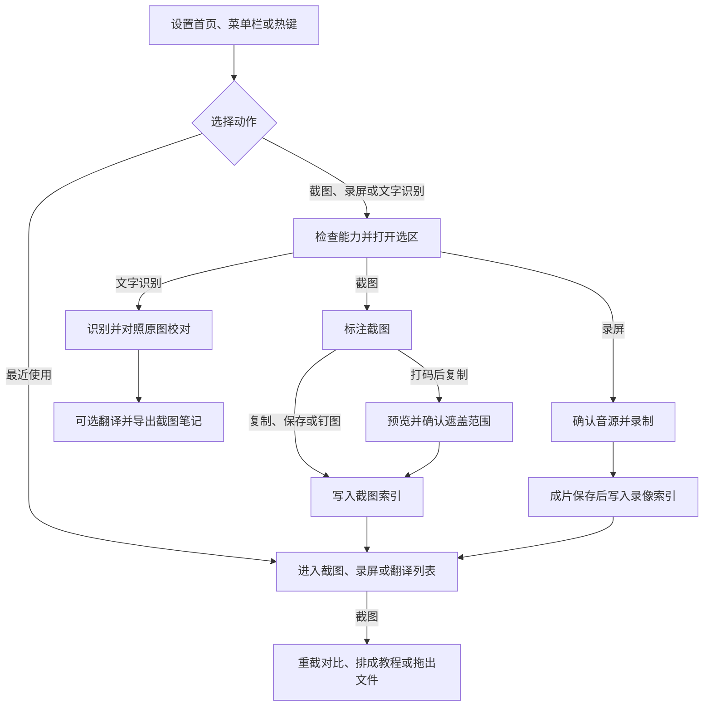

# 设计文档：首次使用体验与截图工作流

- 日期：2026-11-24
- 状态：草稿
- 基线：Snapshoot `master` 的 `feb2e00`。远端无 `develop` 引用。

## 1. 需求理解

- 用户第一次打开 Snapshoot 时，应能直接截图或录屏，并在关闭自动浮层后主动找回截图、录像和译文。
- 让 macOS 系统 OCR 按用户选定的语言重新识别，并能从识别结果定位到原图，方便纠正短词、网址和报错代码。
- 在现有截图流程上增加同区域重截与对比、多图教程、原生拖出、打码确认和截图笔记。录屏增加 macOS 双音源。
- 以本机 macOS v1.2.5 的体验作为参考。截图入口、最近使用和截图交付功能面向 macOS、Windows。上一轮体验只到了录屏设置页，本 RFC 的录屏改动需要真机录制验收。
- 待确认事项为 macOS 双音源的最低支持版本和长时间录制的音画同步表现。先按系统声音已有的 macOS 13 门槛设计，以支持版本上的实测结果确定最终开放范围。

### 已核对的现状

- `README.md` 描述截图历史、录屏、OCR 和自动打码。`src/window/Config/pages/General/index.jsx` 的截图卡片链接到热键设置，`src/window/Config/pages/Record/index.jsx` 提供录屏参数。热键通过 `src-tauri/src/hotkey.rs` 调用截图或录屏入口，最终复用 `src-tauri/src/window.rs` 的 `open_frozen_overlay`。
- `src-tauri/src/quick_access.rs` 用本地 JSON 索引保存最近 60 张截图及其缩略图。`show_quick_access` 可以主动打开浮层，`show_pending` 才读取自动浮层开关。`src/utils/history.js` 创建的 SQLite `history` 表保存译文，`src/window/Config/pages/History/index.jsx` 查询该表。`src-tauri/src/screen_record/mod.rs` 把最后一次录屏结果存在进程内，`src/window/RecordResult/index.jsx` 使用它显示结果卡。
- `src/services/recognize/system/index.jsx` 已传递语言标识。`src-tauri/src/system_ocr.rs` 的 macOS `system_ocr` 忽略该参数，`src-tauri/src/vision_ocr.m` 开启自动检测。`system_ocr_layout` 已返回行框、置信度和二维码信息，供截图内翻译及打码使用。上轮 `iOS` 被误读为 `BOS`，选择简体中文重试结果相同。语言参数未生效已有源码依据，字符误读仍需用样本独立复验。

### 文档与代码差异

| 位置 | 差异 | 提交依据与类型 |
| --- | --- | --- |
| `docs/design/0003-区域录屏.md` 第 1、2、5、7 节。`src-tauri/src/screen_record/mod.rs` 的 `screen_record_support`、`src-tauri/src/screen_record/macos_record.m` 的 `sr_start`、`src-tauri/Info.plist`。 | 0003 记载首期排除麦克风，能力接口仅列 `supported` 和 `system_audio`，权限说明仅涉及屏幕录制。当前实现已新增 `microphone` 能力、macOS 麦克风单音源和对应权限声明，Windows 仍为系统声单音源。 | **文档过期。** `df3f2d66a94455762deffa84f862f198624d5fcc`（ziggy，2026-11-03，《新增区域录屏（Windows）并修复副屏截图与设置窗口还原》）建立首期范围与接口。`9daf17c71da06270d3fdfb33f71863ff81b3945c`（ziggy，2026-11-03，《更新区域录屏设计文档：标记已实现并补充实现差异与验收结果》）确认首期范围。`e8285d1c6765a3ec0b84cfd0fd56e8a41a5f27fb`（shenziggy0，2026-11-08，《优化整体的体验，与竞品对齐》）接入 macOS 麦克风及权限声明、扩展能力接口。 |

## 2. 接口改动

### 桌面命令与入口

下表为拟新增或扩展的内部 Tauri 命令。新增命令在 `src-tauri/src/main.rs` 注册，失败以可本地化的错误键返回。现有本机 HTTP 接口遵循原协议。

| 命令与位置 | 入参和返回 | 行为、失败与兼容 |
| --- | --- | --- |
| 新增 `start_capture`，`src-tauri/src/window.rs` | `mode` 为 `annotate` 或 `record`，返回请求受理结果。 | 复用 `open_frozen_overlay` 的采集门闩和选区预热。已有截图卡片改为开始截图，修改热键用独立链接。录屏页显示当前音源、保存位置和启动按钮。保存中的录屏、在途选区或长截图返回 `capture.busy`，不支持录屏返回 `screen_record.unsupported`。采集启动后的失败沿用现有提示。录屏热键正在录制时仍可停止。 |
| 新增 `record_history_list` 和 `record_history_action`，`src-tauri/src/screen_record/mod.rs` | 列表命令无入参，返回录屏历史条目及文件是否存在。操作命令接收 `id` 和 `open`、`copy`、`reveal`、`forget` 之一，返回操作结果。 | 定位、复制复用已有平台函数，路径由后端从索引解析。路径失效返回 `record_history.file_missing`，仍可移除记录。`forget` 只移除索引。`screen_record_last_result` 继续服务现有结果卡。 |
| 扩展 `system_ocr_layout`、修复 macOS `system_ocr`，`src-tauri/src/system_ocr.rs` 与 `vision_ocr.m` | `system_ocr_layout` 保留 `data`，增加可选 `lang`，仍返回 `OcrLayout`。`system_ocr` 保留现有入参和纯文本返回。 | 自动模式使用自动检测，手动模式将实际支持的语言传给 Vision。不支持的语言返回 `ocr.language_unsupported`。已有打码和截图内翻译省略 `lang`，沿用自动模式。macOS OCR 窗口用自身持有的图片请求结构化结果，按行定位原图并保留编辑能力。纯文本服务继续展示可编辑文本。 |
| 扩展 `capture_history_add`，`src-tauri/src/quick_access.rs` | 保留 `data`、`action`、`showQuick`，增加可选 `region`，返回兼容原有 `CaptureHistoryItem` 的条目。 | 普通截图完成时记录坐标。图片编辑、长截图及旧条目允许没有坐标。只有坐标元数据无效时仍保存成图，并略过重截入口。 |
| 新增 `recapture_region` 和 `capture_history_drag`，复用 `src-tauri/src/quick_access.rs` 的条目查找。采集走 `screenshot.rs`，拖出走新原生桥接。 | 均以截图历史 `id` 为入参。重截返回请求受理结果，拖出返回原生拖放是否启动。 | 重截检查屏幕身份和像素规格，显示预填选区供确认。显示器不可用时提示重新框选。拖放仅接受历史中的完整 PNG，使用原生文件拖放交给目标程序，保留本次拖放期间使用的文件。WebView 图片拖动和文件剪贴板无法提供这个交互。 |
| 扩展 `screen_record_support`，`src-tauri/src/screen_record/mod.rs`；混音由 `macos_record.m` 实现。 | 支持能力返回值增加 `dual_audio`，`screen_record_start`、`RecordStatus` 和 `RecordResult` 的签名不变。 | macOS 复用 ScreenCaptureKit 系统声和现有麦克风采集，统一采样率、声道与时间轴，混为单条 AAC 音轨。音源不可用时在开始前提示，用户可以调整音源后重试。Windows 继续公布自身支持的能力。 |

### 界面内的数据流

- **最近使用。** 在 `src/window/Config/routes/index.jsx` 和侧栏加入常驻入口，菜单栏能直接打开。截图复用 `QuickAccess` 的缩略图与操作，录屏读新索引，翻译复用现有 `History` 列表。旧 `/history` 链接继续打开翻译记录。自动浮层仍由原开关控制。
- **对比与教程。** 同区域重截复用 `src-tauri/src/screenshot.rs` 的屏幕采集和 `src/window/Screenshot/index.jsx` 的 `selectionImageRect`。对比接收两张图片，尺寸匹配时支持并排、滑块和并排 PNG 导出，尺寸不同时只允许并排预览和导出。教程以选中的截图 ID 和排序为输入，复用 `src/window/Annotate/render.js` 里的编号、箭头和 Canvas 渲染，再用已有 PNG 保存命令导出。图片缺失时在预览中提示，用户可移除该步后继续。
- **打码后复制。** `src/window/Screenshot/index.jsx` 复用 `system_ocr_layout` 和现有马赛克渲染，候选区域先进入预览，支持逐块取消与手工补遮。识别失败时显示手工处理入口。确认时将遮盖渲染进导出像素，复制和新增历史条目使用同一份成图。取消时恢复进入预览前的编辑状态。
- **截图笔记。** 从 `src/window/Recognize` 使用当前原图和用户校对后的文本。用户主动点翻译时复用 `src/utils/translate_once.js`，来源由用户填写。单文件 HTML 嵌入 PNG，并转义用户文字。Markdown 复制输出文字、译文和来源。翻译不可用时保留原图和原文，允许重试或先导出。

## 3. 数据库改动

SQLite 无表、字段或索引变更，翻译继续使用 `history`，无需回滚 DDL。下面两处使用本地 JSON，沿用当前桌面应用的数据边界。

| 数据 | 设计与兼容 |
| --- | --- |
| 截图索引 | 在现有 `capture_history/index.json` 条目上增加可选选区。保存显示器标识或平台可取得的匹配信息、捕获时的像素宽高及显示器内矩形。旧条目缺少字段时照常反序列化。只有目标能唯一匹配且像素规格相同时才预填选区。历史条数沿用 60 张。 |
| 录像索引 | 在应用数据目录使用独立的 `record_history.json`，记录 `id`、路径、时间、宽高、时长、文件大小和帧率。以最近 60 条为首版上限，淘汰记录只删索引条目。复用录屏结果提供的元数据，文件仍由原录屏保存路径管理。旧录像可从原文件夹打开。 |
| 音源配置 | 使用现有 `record_system_audio`、`record_microphone` 两个布尔配置。在支持双音源的客户端独立保存两项。遇到无法启用的组合时按当前能力向用户说明，等待用户选择音源。 |

索引用同目录临时文件加替换写入。录像完成保存后再登记，索引写入失败时仍显示成片位置和「未加入最近使用」。删除录像结果时同步移除对应索引项。截图、录像和译文的实体数据继续由各自现有流程管理。

## 4. 流程图

## 5. 范围边界

- 第一批交付直接截图和录屏入口、最近使用，以及 macOS OCR 语言和原图定位修复。
- 第二批交付同区域重截与对比、多图教程、原生拖出、打码确认、截图笔记。
- 第三批交付 macOS 双音源混录。现有单音源和停录流程纳入回归。
- 范围止于本地工作流和现有翻译服务。账号、云同步、录像自动扫描导入、Windows 麦克风、视频编辑及界面风格重做另立需求。
- 实施前复核现有接口与仓库说明，优先复用采集、画布和导出。新增结构须说明现有实现为何不足，命名和职责保持清晰，测试以核心用户路径为准。交付时更新 README 的入口说明和平台能力表述。

## 6. 验收标准

- [ ] 在支持录屏的 macOS、Windows 真机上使用新配置，从设置页完成一张截图和一段录屏，无需先设置热键。截图可粘贴，MP4 可播放。已有截图快捷键可用，录屏控制条能停止录制。权限不足时显示对应设置入口。
- [ ] 关闭自动浮层后，各完成一次截图、录屏、翻译，重启后通过「最近使用」找回三项。旧截图和译文仍可读。移走测试录像后列表显示文件已移动或删除，移除记录可正常完成。
- [ ] 用同一张中英混排原图分别运行自动、简体中文和英文 OCR，核对 Vision 实际收到的语言。用清晰样本检查 `iOS` 等短词，用原体验样本记录实际结果。点识别行能定位对应图像区域，编辑后的文字可复制。
- [ ] 在高分屏上对同一个测试界面截取改前、改后，重截得到相同像素尺寸，固定边缘在并排和滑块预览中对齐。改变目标显示器规格后显示重新框选入口。三张图按调整后的顺序生成含三步编号的 PNG。
- [ ] 用含测试邮箱的图片预览自动打码、手动补遮并确认。核对剪贴板与新历史图只有确认后成图。从历史拖到支持文件的 Finder、资源管理器或本地草稿附件区，得到同一份可打开的 PNG，预先复制的文本仍可粘贴。把同一张打码图导出为笔记，移离截图缓存后 HTML 仍能显示图、文字、译文和来源。
- [ ] 在支持双音源的 macOS 上播放可辨认的系统音，同时用麦克风录入旁白，中间暂停并继续。用系统播放器确认两路可听、暂停段未混入、片头和片尾的可见动作与声音同步。Windows 可继续录制系统声音。

## 7. 影响面

- **桌面入口与采集。** `General`、`Record`、设置路由、菜单栏和热键共享现有覆盖层启动逻辑。屏幕截图和录屏继续使用已有平台支持与权限判断。
- **历史与存储。** 常驻入口会读取三份数据。截图继续用缩略图减轻列表渲染负担，录像索引只保存元数据。新条目写入失败时按各自原动作结果反馈，已保存的文件仍能定位。
- **图像交付。** 对比和教程按需要读取原图。拼图超过当前 Canvas 可导出的尺寸时提示缩小或减少选图。打码候选及 OCR 原文保留在当前操作所需的内存中。翻译沿用已有服务配置与数据发送提示。
- **录屏与兼容。** 双音源会增加音频缓冲与编码前处理，实施时在支持系统上记录 CPU、成片时长和音画同步。采集和编码继续输出现有 MP4 格式，应用整体最低系统版本沿用当前基线。

## 8. 回滚方案

- 按三批拆分可单独回退的提交。入口或最近使用出现阻断时回退对应界面及桌面命令，恢复原热键、自动浮层和翻译历史入口。OCR 语言或图文定位出现回归时回退该批识别调用，恢复原文本输出。
- 重截、教程、拖出、遮盖或笔记导出出现错误时回退相应入口与实现。已导出的 PNG 和 HTML 留在用户选定的位置。历史索引的可选字段可被旧客户端忽略，独立录屏索引保留供后续版本恢复。
- 双音源发生录制失败、明显不同步或单音源回归时，先关闭 `dual_audio` 能力并恢复原音源互斥逻辑。两项配置均开启的用户按原逻辑使用麦克风，并可在录屏设置重新选择。已有 MP4 保留。
